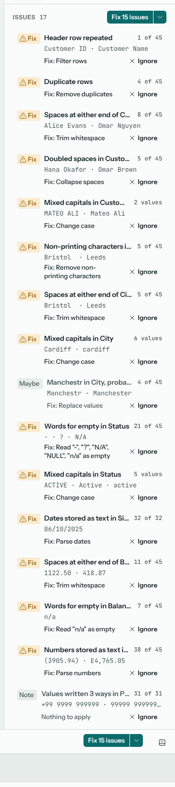
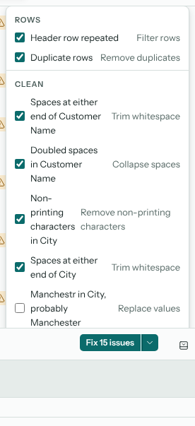
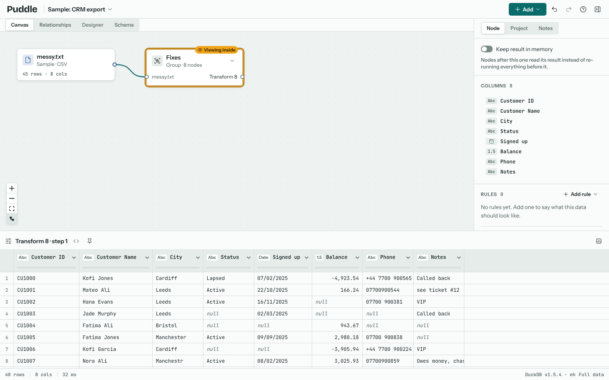

# Analysing a file

Every source, and any node you look at, is analysed in the background once it has run: Puddle reads its first rows, looks for the problems messy files usually have, and lists what it finds on the **Issues** panel in the inspector. Each issue comes with the fix Puddle would apply, and **Fix all** applies them in one go, as steps you can see, change and undo.

The source's node on the canvas shows how many issues it has, so a file that needs work stands out before you open it. Analysis reads the first two hundred thousand rows of a node, which is enough to find what is wrong without slowing a large file down; the panel says so when it looked at a sample.

## What an issue says

Each issue is one line: what was found and where (*Spaces at either end of name*), how many rows or values it touches, two or three values from the data that show it, and a badge:

Fix
: A problem with one right answer, such as spaces at the ends of values or a header row pasted in again. **Fix all** applies these.

Maybe
: A change that could alter what the data means, such as removing a total row or replacing a likely misspelling. Puddle suggests it but leaves it unticked, so it is applied only when you choose it.

Note
: Something worth knowing with no fix to apply: a column with one value throughout, or an id column with repeats (a **Unique** rule in the Rules section will keep watch).

Hover an issue for a line on what it means and what the fix does. The kinds of issue Puddle looks for:

| Issue | What it means | The fix |
| --- | --- | --- |
| Lines above the table, Lines after the table | A title, a date or page headings before the header row; a row count, a signature or "End of report" after the last row. | Read options: skip the lines at the top or the rows at the bottom. |
| Header row repeated | The header appears again inside the data, as when two exports were pasted together. | Filter rows that match the header. |
| Separator and page-break rows, Blank rows | Rows with only the first column filled (lines of dashes, page breaks, headings on a later page), or nothing in any column. | Filter rows. |
| Total rows inside the data | Rows that sum the rows above them; keeping them would count every value twice. | Filter rows (a suggestion). |
| Merged cells left empty | Cells merged in a sheet have their value in the first cell only, so the rows below read as empty. | Read options: fill merged cells. |
| Rows shifted one column over | A cell was deleted or inserted, so from that column on the values sit under the wrong headers. | Realign rows, then the types the columns lost. |
| Spaces at either end, Doubled spaces, Non-printing characters, Empty text | Untidy text: values that start or end with a space, runs of spaces, hidden characters, text with nothing in it. | Trim whitespace, Collapse spaces, Remove non-printing characters, Empty text to empty value. |
| Mangled characters | Text saved in the wrong encoding: `é` for `é`. | Fix mangled characters. |
| Mixed capitals | The same value written with different capitals, so it counts as several. | Change case to the form most of the values use. |
| Words for empty | Values such as `n/a`, `none` or a dash that stand for nothing. | Read options: treat them as empty. |
| Numbers stored as text, Dates stored as text, Yes and no stored as text | Values that would sort, sum and compare if they had their type. | Parse numbers (with the decimal mark the column uses), Parse dates (with the formats the column uses), Change type. |
| Dates stored as numbers | Excel serial numbers or Unix times in a column named for a date. | Parse dates. |
| Mostly numbers (or dates), with values that aren't | Most values read as numbers or dates, but some don't; parsing makes those empty. | Parse numbers or Parse dates (a suggestion). |
| A value, probably a misspelling | A value nearly the same as a more common one. | Replace values (a suggestion). |
| Values written several ways | A phone number with and without spaces, a code with and without its prefix. | Find and replace, where one shape is clearly meant. |
| Duplicate rows | Rows that repeat another row exactly. | Remove duplicates. |
| Untidy column names | Names with spaces at the ends, doubled spaces, hidden characters, or not in the project's chosen style. | Rename columns (see [Settings](#settings)). |
| Nothing in a column, Row numbers in a column | A column that is empty throughout, or counts the rows as a spreadsheet export adds. | Remove the column. |
| Months or years as columns | One column per period. | Unpivot (a suggestion). |
| Keys and values together | Cells such as `Total: 1,234`. | Split column (a suggestion). |
| One value throughout, Repeated values in an id | Notes, with no fix. | |

## Fix all

**Fix all** sits on the Issues panel and above the results table. One click applies every issue marked **Fix**; the button says how many (**Fix 6 issues**). The arrow beside it opens **Choose fixes**, which lists every fix with a checkbox, grouped the way the Add menu groups steps, with the suggestions unticked: tick the ones you want and choose **Apply**.

The fixes land in two places:

- Read options go on the source itself: lines skipped at the top and bottom, words treated as empty, merged cells filled. The file is read differently, and nothing is added to the canvas.
- Everything else is a step. With **Add each step as a new node** on (the default), each step is a Transform node of its own, wired after the node you fixed in the order the fixes should run (the table's shape first, then text, then types, then duplicates), and gathered in a group named **Fixes**. With it off, they stack into one Transform.

The whole of Fix all is one change: Ctrl+Z undoes it. Each step is an ordinary step, so you can open the **Fixes** group, change a step's settings, turn one off or delete it, as {doc}`cleaning` describes. Fix all looks at the data where you are, so after one pass the node at the end of the group is analysed in turn, and what is left (a number column now clean enough to parse, say) is a second **Fix all** away.

## Ignoring an issue

Not every issue is a problem. **Ignore** on an issue's line takes it off the panel for that node, and the count on its node drops. The panel's footer says how many are ignored and **Show** brings them back. Ignored issues are saved with the project, and the quality report lists them as ignored (see {doc}`exporting`).

## Settings

Two project settings on the inspector's **Project** tab shape Fix all (see {doc}`settings`):

Fix all applies suggestions
: Off for a new project: **Fix all** applies the fixes marked **Fix** and leaves the suggestions for **Choose fixes**. On, the suggestions are ticked too.

Column names
: How **Untidy column names** is fixed: the words as they are, with the spaces at the ends and hidden characters removed, or snake_case (`order_date`). With snake_case chosen, every column not in that style is an issue.

## Outside the browser

What Fix all found and did on a node is kept with the project, so the quality report (**Write quality report** on the node) lists every issue with its outcome: fixed, ignored or still open. `puddle-run` writes the same report when it runs the project, and `puddle-run analyse` prints a file's issues with no project at all. See {doc}`exporting` and {doc}`self-hosting`.
