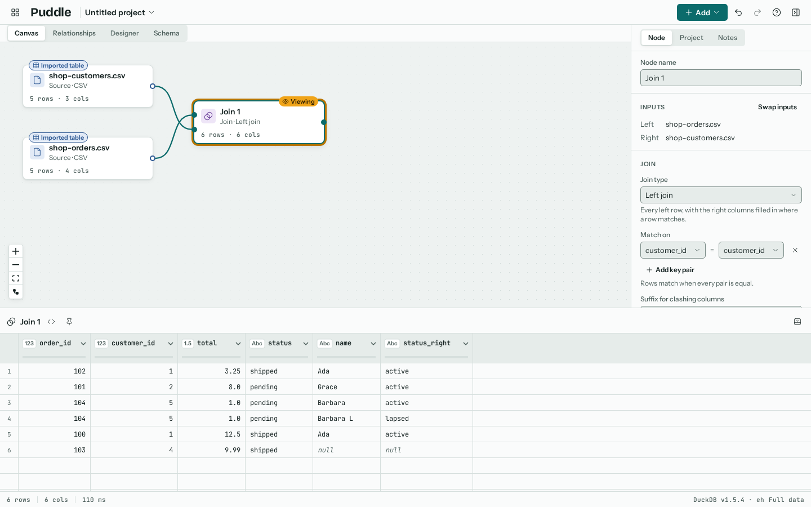
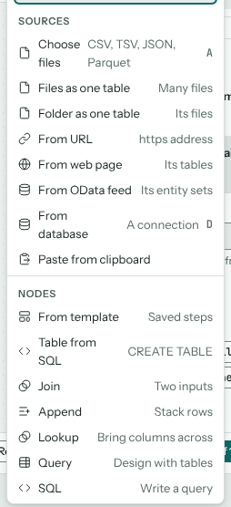
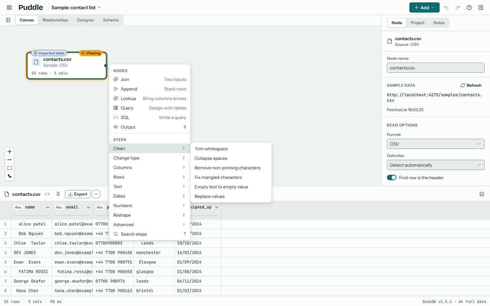
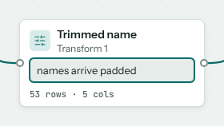
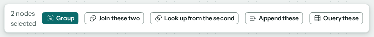
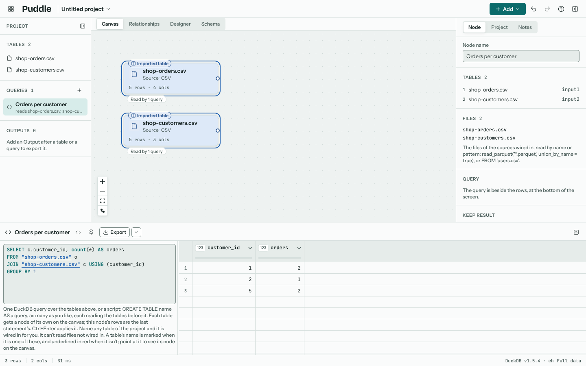
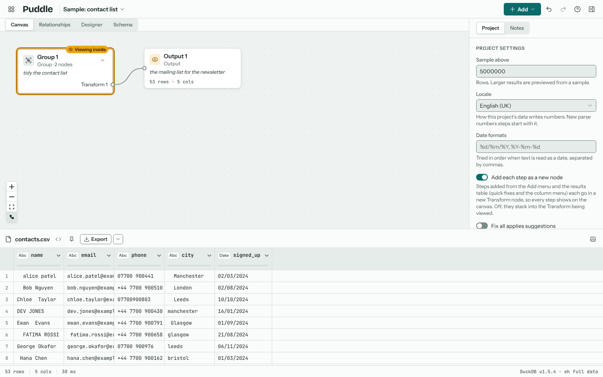
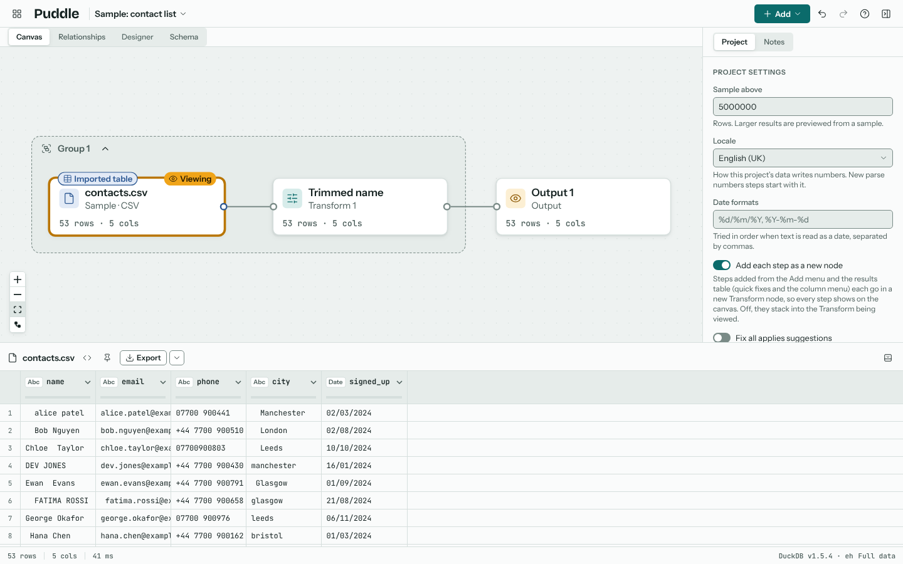
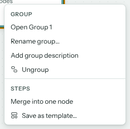

# The canvas

The canvas is where your flow lives. Tabs above it switch to the {doc}`relationships` view and, once the project has a Query node, the {doc}`query designer <query-designer>`. Data runs left to right along wires: sources feed transforms and other nodes, and those feed outputs. Every node shows its row and column counts, and a badge when one of its rules fails.

## Kinds of node

**Add** in the toolbar adds a source, a node after the selected one, or a step, which goes in a Transform node of its own after the selected node. A node you add is selected and shown in the results straight away (unless the results are pinned). New nodes always arrive wired, so the menu lists only what can be added now: with nothing selected it has the sources and the nodes that need no input, with a line saying to select a node for the rest; with a node selected the other nodes and the steps join them.

You can also add the next node from where you are looking: click a node's right-hand connector. A menu opens beside it with the same nodes and steps as the Add menu, the steps in a submenu for each group (**Clean**, **Change type**, **Columns** and so on), and **Search steps** at the end for the Add menu's search. What you pick goes after that node, wired from it. Dragging from the connector still draws a wire.

| Node | What it does | More |
| --- | --- | --- |
| Source | Reads a file, a web address or pasted rows. | {doc}`sources` |
| Transform | A cleaning step, or a list of them, applied in order. Any step in the Add menu makes one. | {doc}`cleaning` |
| From template | Steps you saved earlier, as a chain of Transforms in a group. | {doc}`projects` |
| Join | Combines two inputs side by side on matching keys. | {doc}`combining` |
| Append | Stacks the rows of two or more inputs. | {doc}`combining` |
| Lookup | Brings columns across from a second input, keeping every row of the first. | {doc}`combining` |
| Query | Designs a query over several tables with a grid, in the style of Access. | {doc}`query-designer` |
| Schema table | A table designed in the Schema view, as a real DuckDB table holding its records and any rows wired into it, checked against its keys, types and checks. | {doc}`schema` |
| SQL | A DuckDB query you write over the tables it names (any node of the project, by its name) or the nodes wired into it (`input1`, `input2`...); or a script of `CREATE TABLE` statements. It can read the files of the sources wired into it by name. | {doc}`combining` |
| Script table | One table a script creates with `CREATE TABLE name AS`, in a SQL node or a Query's SQL view, as a node of its own. | {doc}`combining` |
| Output | Marks data that's ready, and exports it. | {doc}`exporting` |

Nodes that are tables in their own right carry a tag on the top edge of their card, so they stand out from the nodes that work on them. **Imported table** marks a source: a file, a web address, a database table or pasted rows. **SQL table** marks a table a script created with `CREATE TABLE name AS`.

## Renaming a node

Give a node a name that says what it holds: select it and press F2, or right-click it and choose **Rename…**, or change **Node name** in the inspector. The name shows on the card and in the results, and it is the name SQL reads the node by: a SQL node or a Query's SQL that reads the node by its old name is rewritten to read it by the new one, as part of the same change, so one undo puts both back. Where the query already uses the new name for something else, it is rewritten to the node's numbered name (`input1`) instead. A renamed source still says which file it reads in the inspector.

## Describing what a node is for

A name says what a node holds; a description says why it is there, in your own words: "combine into a single list", "touchless rate per month". It shows under the node's heading on the canvas, so a flow with many steps reads at a glance. Right-click a node and choose **Add description**, type a few words and press Enter. To change it, right-click the node and choose **Edit description**, or change **Description** in the inspector, under **Node name**. Escape leaves it as it was, and clearing the words removes it. A description is one line of up to 140 characters; the card shows the first two lines of it, and the rest on hover. For anything longer, use the node's notes in the inspector.

Groups take a description too (see [Groups](#groups)). Descriptions are saved with the project and never change what runs.

## Selecting, viewing and moving

- Click a node to select it. Its settings show in the inspector and its data in the results; a **Viewing** tag marks the node whose data is shown.
- Shift+click adds nodes to the selection. With two or more selected, a bar offers to join, look up, append or query them, to group them (G), or, when they sit in a longer line of Transforms, to **Group the chain**.
- Drag a node to move it. **Auto layout** (L), in the canvas controls at the bottom left, arranges the whole flow neatly.
- Drag from a node's right-hand handle to another node's input to wire them. Click the handle instead to add a node or step after it. Select a wire and press Delete to remove it.
- The zoom buttons sit at the bottom left. An overview map appears at the bottom right when part of the flow is off screen.
- The canvas keeps what you are working on in view. A node you add or select off screen is panned into view, and a project you open, such as a sample, starts with all its nodes showing. A project you have already panned or zoomed opens where you left it.

## Using the keyboard

Arrow keys move between connected nodes and show each one in the results, as a click does (with the results pinned they only select, and V moves the pin to the selected node). Enter opens the selected node, F2 renames it, T opens the Add menu to add a step after it, O adds an Output, and G groups the selected nodes. C starts wiring the selected node: move to another node and press Enter to wire or unwire them. 1, 2, 3 and 4 switch between the canvas, the relationships view, the query designer and the Schema view. **?** lists every shortcut (see {doc}`settings`).

## The project panel

The project panel lists the project beside the canvas, as a database's navigation pane does: its **Tables** (sources, tables made with SQL or designed in the schema, joins, and the end of each run of cleaning steps), its **Queries** (SQL nodes and Query nodes that ask something of those tables) and its **Outputs**. Click a row to select its node and see its rows; right-click it to rename or delete it. A query row says which tables it reads.

The panel shows itself the first time a query is listed in it. The button at the left of the view tabs shows it at any other time, and the button at its top hides it.

In a new project a query that ends a flow is in the panel only, not on the canvas. The canvas then shows how the tables are made, and the panel shows what is asked of them:

- **New query** (the plus beside Queries) makes a query that reads the selected table and asks you to name it.
- A query reads any table of the project by naming it in its SQL. Nothing is wired by hand: Puddle wires the table in when the query names it, and lets go again when it no longer does.
- A table read by such queries says so under its card (**Read by 2 queries**); click that to go to the first of them. Selecting a query marks the tables it reads.
- A query whose rows feed more steps is part of how a table is made, so it is drawn on the canvas like any node. Add a step after a query and it appears there.
- A script that creates tables stays on the canvas, as one card: the SQL node and its tables are gathered into a group named after the node. Open the group to work on them.

A project made before the panel keeps its queries on the canvas. **Move queries to the panel**, under Queries, changes that, and the project setting **Keep queries in the project panel** switches it either way (see {doc}`settings`).

## Groups

A group gathers nodes together and can hide them behind a single card, as node groups do in Blender. It is the one way to bundle nodes: a group can be closed to a card, saved as a template, or merged into one node. Select two or more nodes (Shift+click adds to the selection), then press G or choose **Group** on the selection bar. You can also right-click a selected node and choose **Group**, or **Group the chain** to gather the whole line of Transforms wired one after another through it, which is the usual way to bundle a run of cleaning steps. A chain grouped this way is named after what it cleans, such as **Clean contacts.csv**.

A closed group is one card. It has a socket on the left for each wire coming in from outside the group, and one on the right for each result going out, named after the node it comes from. Click a result's name to see its data in the results. Drag from a result's socket to wire it into another node.

Double-click the card, or click its arrow, to open the group. It opens as a frame round its nodes, so you can work on them as usual, and the frame's arrow closes it again. If other nodes sit where the group's nodes are, opening it moves them along to the right to make room.

Right-click a group to open or close it, rename it, describe it, or **Ungroup** it. **Add group description** says what the group's nodes do together, such as "tidy the contact list"; it shows on the closed card and at the top of the open frame, and **Edit group description** changes it. Ungrouping leaves the nodes where they are, wired as they were. Groups only change how the canvas looks: every node runs the same whether its group is open or closed. **Auto layout** treats a closed group as one node.

A group that is a line of Transforms has more on its menu: **Merge into one node** runs their steps as one Transform and **Split into the original nodes** puts them back (see [Merging a group into one node](cleaning.md#merging-a-group-into-one-node)), and **Save as template** keeps their steps for any project (see [Templates](projects.md#templates)).
