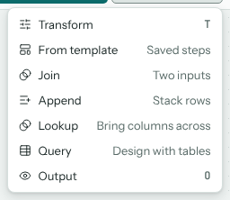

# The canvas

The canvas is where your flow lives. Data runs left to right along wires: sources feed transforms and other nodes, and those feed outputs. Every node shows its row and column counts, and a badge when one of its rules fails.

## Kinds of node

**Add node** adds a node after the selected one.

| Node | What it does | More |
| --- | --- | --- |
| Source | Reads a file, a web address or pasted rows. | {doc}`sources` |
| Transform | A list of cleaning steps, applied in order. | {doc}`cleaning` |
| From template | A Transform with steps you saved earlier. | {doc}`projects` |
| Join | Combines two inputs side by side on matching keys. | {doc}`combining` |
| Append | Stacks the rows of two or more inputs. | {doc}`combining` |
| Lookup | Brings columns across from a second input, keeping every row of the first. | {doc}`combining` |
| Query | Designs a query over several tables with a grid, in the style of Access. | {doc}`query-designer` |
| Output | Marks data that's ready, and exports it. | {doc}`exporting` |

## Selecting, viewing and moving

- Click a node to select it. Its settings show in the inspector and its data in the results; a **Viewing** tag marks the node whose data is shown.
- Shift+click adds nodes to the selection. With two or more selected, a bar offers to join, look up, append or query them, or to group Transform nodes into one.
- Drag a node to move it. **Auto layout** (L) arranges the whole flow neatly.
- Drag from a node's right-hand handle to another node's input to wire them. Select a wire and press Delete to remove it.
- The zoom buttons sit at the bottom left, and the overview map at the bottom right.

## Using the keyboard

Arrow keys move between connected nodes, Enter opens the selected node, T adds a Transform after it and O an Output. C starts wiring the selected node: move to another node and press Enter to wire or unwire them. **?** lists every shortcut (see {doc}`settings`).
