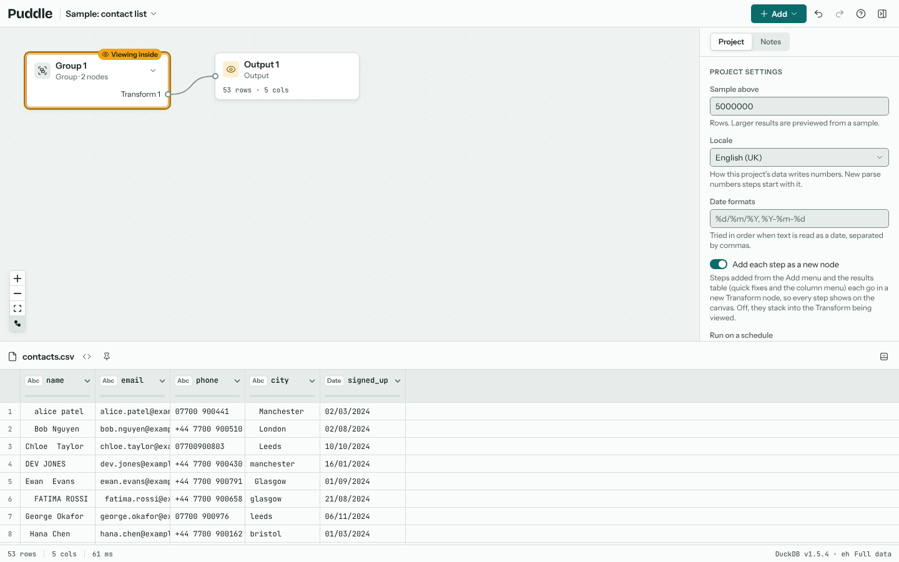
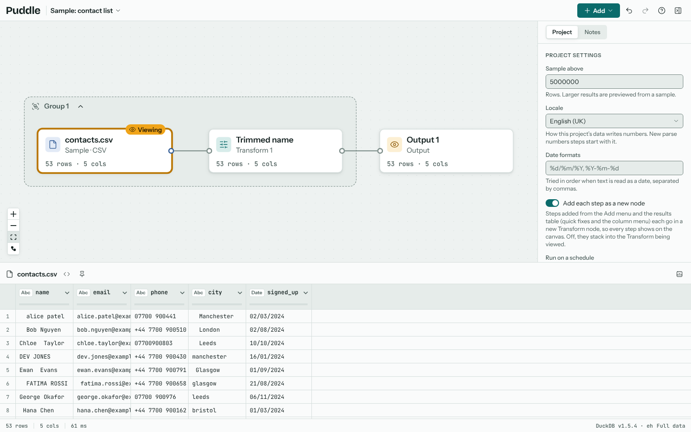
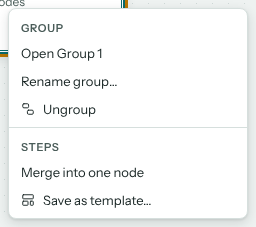

# The canvas

The canvas is where your flow lives. Data runs left to right along wires: sources feed transforms and other nodes, and those feed outputs. Every node shows its row and column counts, and a badge when one of its rules fails.

## Kinds of node

**Add** in the toolbar adds a source, a node after the selected one, or a step, which goes in a Transform node of its own after the selected node.

| Node | What it does | More |
| --- | --- | --- |
| Source | Reads a file, a web address or pasted rows. | {doc}`sources` |
| Transform | A cleaning step, or a list of them, applied in order. Any step in the Add menu makes one. | {doc}`cleaning` |
| From template | Steps you saved earlier, as a chain of Transforms in a group. | {doc}`projects` |
| Join | Combines two inputs side by side on matching keys. | {doc}`combining` |
| Append | Stacks the rows of two or more inputs. | {doc}`combining` |
| Lookup | Brings columns across from a second input, keeping every row of the first. | {doc}`combining` |
| Query | Designs a query over several tables with a grid, in the style of Access. | {doc}`query-designer` |
| SQL | One DuckDB query you write over any nodes wired into it, readable as `input1`, `input2`... or by their names. | |
| Output | Marks data that's ready, and exports it. | {doc}`exporting` |

## Selecting, viewing and moving

- Click a node to select it. Its settings show in the inspector and its data in the results; a **Viewing** tag marks the node whose data is shown.
- Shift+click adds nodes to the selection. With two or more selected, a bar offers to join, look up, append or query them, to group them (G), or, when they sit in a longer line of Transforms, to **Group the chain**.
- Drag a node to move it. **Auto layout** (L), in the canvas controls at the bottom left, arranges the whole flow neatly.
- Drag from a node's right-hand handle to another node's input to wire them. Select a wire and press Delete to remove it.
- The zoom buttons sit at the bottom left. An overview map appears at the bottom right when part of the flow is off screen.

## Using the keyboard

Arrow keys move between connected nodes, Enter opens the selected node, T opens the Add menu to add a step after it, O adds an Output, and G groups the selected nodes. C starts wiring the selected node: move to another node and press Enter to wire or unwire them. **?** lists every shortcut (see {doc}`settings`).

## Groups

A group gathers nodes together and can hide them behind a single card, as node groups do in Blender. It is the one way to bundle nodes: a group can be closed to a card, saved as a template, or merged into one node. Select two or more nodes (Shift+click adds to the selection), then press G or choose **Group** on the selection bar. You can also right-click a selected node and choose **Group**, or **Group the chain** to gather the whole line of Transforms wired one after another through it, which is the usual way to bundle a run of cleaning steps.

A closed group is one card. It has a socket on the left for each wire coming in from outside the group, and one on the right for each result going out, named after the node it comes from. Click a result's name to see its data in the results. Drag from a result's socket to wire it into another node.

Double-click the card, or click its arrow, to open the group. It opens as a frame round its nodes, so you can work on them as usual, and the frame's arrow closes it again. If other nodes sit where the group's nodes are, opening it moves them along to the right to make room.

Right-click a group to open or close it, rename it, or **Ungroup** it. Ungrouping leaves the nodes where they are, wired as they were. Groups only change how the canvas looks: every node runs the same whether its group is open or closed. **Auto layout** treats a closed group as one node.

A group that is a line of Transforms has more on its menu: **Merge into one node** runs their steps as one Transform and **Split into the original nodes** puts them back (see [Merging a group into one node](cleaning.md#merging-a-group-into-one-node)), and **Save as template** keeps their steps for any project (see [Templates](projects.md#templates)).
