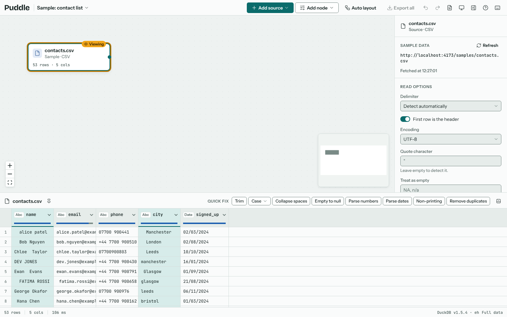
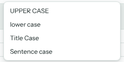
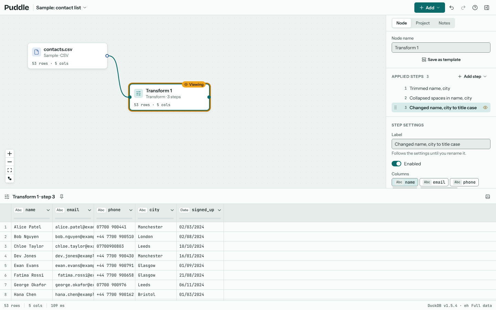
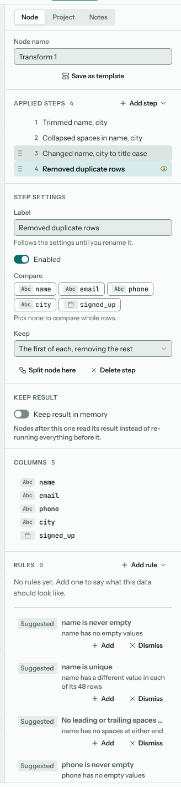
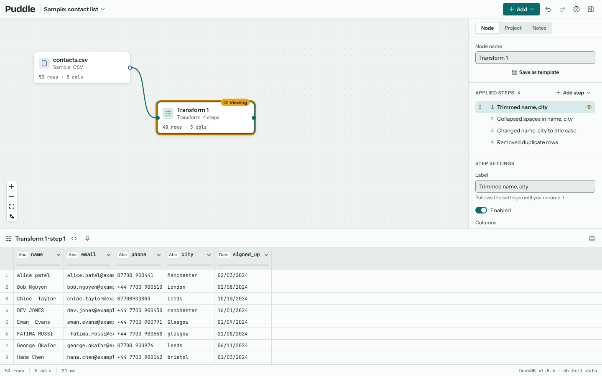
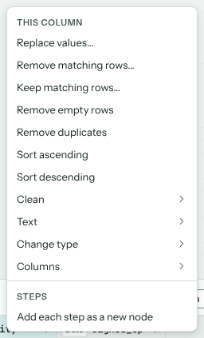
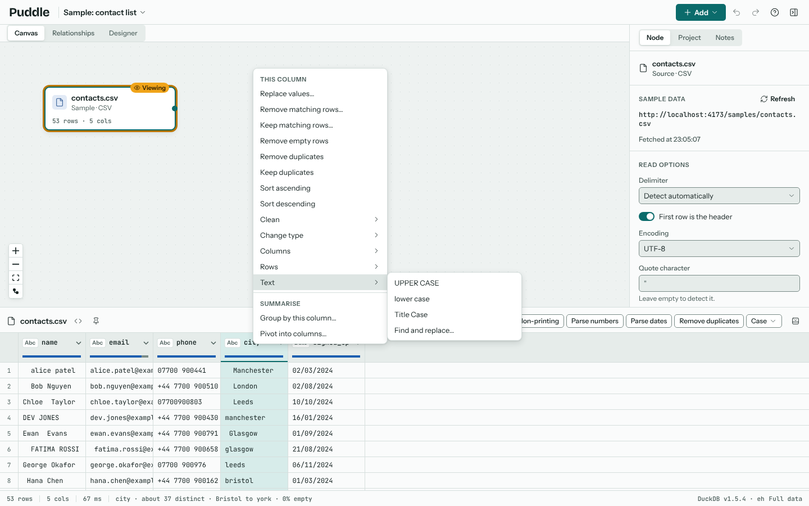
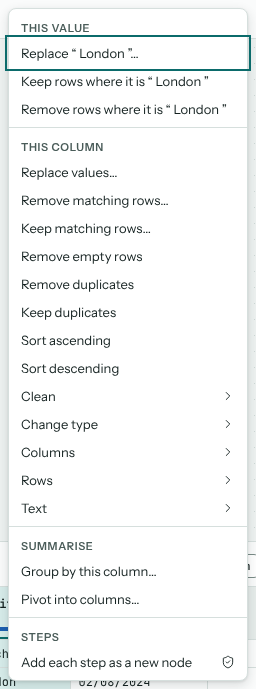
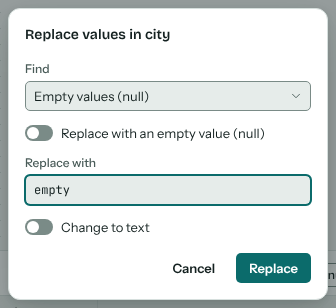
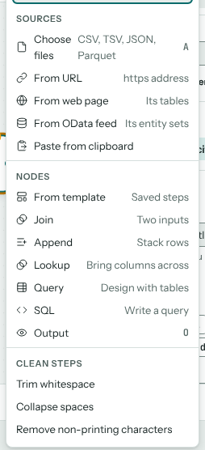

# Cleaning data

Cleaning in Puddle is a list of steps in a Transform node. Each step does one thing, such as trimming spaces or parsing dates, and the steps run in order. Nothing changes your file: the steps are a recipe that DuckDB runs each time you look at the data.

There are three ways to add steps: the quick-fix bar, which covers the common fixes in one click; the column menu, which opens when you right-click a column in the results; and the **Add step** menu, which has every step.

## Quick fixes

Select one or more column headers in the results table, and the quick-fix bar appears above it. Click a header to select it, Ctrl+click (Command+click on a Mac) to add another, or Shift+click to select a range.

| Fix | What it adds |
| --- | --- |
| Trim | Removes spaces from both ends of each value. |
| Case | UPPER CASE, lower case, Title Case or Sentence case. |
| Collapse spaces | Turns runs of spaces inside a value into one. |
| Empty to null | Treats empty text as a missing value. |
| Parse numbers | Reads text such as `£1,234.50` as a number. |
| Parse dates | Reads text as dates, detecting every format the column uses. |
| Non-printing | Removes invisible characters. |
| Remove duplicates | Removes rows that repeat in the selected columns. |

A fix lands where you're looking. On a source, it adds a Transform node after the source. On a Transform, it adds the step after the one you're viewing, so you can fix things in the order you find them.

## Steps in the inspector

Select a Transform node to see its **Applied steps** in the inspector. Each is labelled by what it did, such as "Trimmed name, city". Select a step to change its settings below the list.

With a step selected you can:

- change its settings, and see the results update straight away;
- turn it off with **Enabled**, to see the data without it;
- rename it with **Label** (the label then stops following the settings);
- drag it up or down the list by its handle (or press Alt+Up or Alt+Down) to run it earlier or later;
- delete it with **Delete step**.

Undo (Ctrl+Z) and redo (Ctrl+Shift+Z or Ctrl+Y) cover every change, even with focus still on the setting you just changed. See [Undo and redo](projects.md#undo-and-redo).

## Seeing the data at any step

The results show the data after the selected step, and the results title says which ("Transform 1 · step 1"). Select an earlier step to see the data as it was there, and an eye marks the step being viewed. This is the quickest way to find which step changed something.

## The column menu

Right-click a column header in the results table, or click the arrow at the right of a header, to open the column menu. It works on the columns selected in the results: right-clicking a column that isn't selected selects it first. With a header selected, the context menu key or Shift+F10 opens it from the keyboard.

The top of the menu has the steps you reach for most: **Replace values**, **Remove matching rows**, **Keep matching rows**, **Remove empty rows**, **Remove duplicates**, **Keep duplicates** and the two sorts, then submenus for the rest (below). Under them, **Summarise** has **Group by this column** (or these columns) and, for one column, **Pivot into columns**; both open the pivot editor, where you choose what to summarise and how (see {doc}`reshaping`). **Keep duplicates** shows only the rows whose value in the selected columns appears more than once, every copy of them, so you can look at the repeats before deciding what to do. The submenus hold:

| Submenu | What's in it |
| --- | --- |
| Clean | Trim, Collapse spaces, Remove non-printing characters, Empty text to null, Fill down, Fill up. |
| Text | UPPER CASE, lower case, Title Case, Find and replace, Split column. |
| Change type | Parse numbers, Parse dates, To text, To whole number, To decimal number. |
| Columns | Rename, Duplicate column, Move to the front, Remove column, Remove other columns. |

Right-click a cell and the menu adds a **This value** group at the top for the value in that cell: replace it, keep only the rows that have it, or remove the rows that have it.

Like a quick fix, a step from the column menu lands where you're looking (see [Quick fixes](#quick-fixes)). Items that end in "…" open the step's settings, or a short dialog, before anything is added.

### Replace values

**Replace values** swaps whole values for another value. Choose what to find: a value you type, empty values (null), or empty values and blank text. Then type what goes in their place, or turn on **Replace with an empty value (null)**. A typed value matches the whole value, not part of it, and matches case unless you turn off **Match case** in the step's settings. To change text inside a value, use **Find and replace** instead.

A number or date column can't hold a word such as `empty`. Turn on **Change to text** and the column becomes text first, so the word fits. Puddle turns it on for you when the replacement wouldn't fit, and warns you if you turn it off.

### Each step as a new node

Turn on **Add each step as a new node**, at the bottom of the column menu or in the project settings, to give each step you add from the results table (by the column menu or a quick fix) a Transform node of its own, wired after the one you're viewing. The canvas then shows every step as its own node, the way Power Query lists its applied steps. Viewing an earlier step of a Transform still adds the step in place, after the one you're viewing.

## The Add step menu

**Add step**, above the step list, has every step, grouped as Clean, Columns, Rows, Text, Dates, Numbers, Reshape and Advanced. Type to search it. A new step starts on the columns selected in the results.

The {doc}`step-reference` describes them all.

## Merging Transform nodes

Several Transform nodes in a line can become one: select them, then choose **Merge into one node** on the selection bar. The merged node runs their steps in order, and **Split into the original nodes** in the inspector puts them back. To tidy the canvas without changing any nodes, group them instead (see [Groups](canvas.md#groups)).
