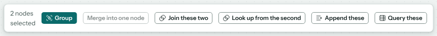
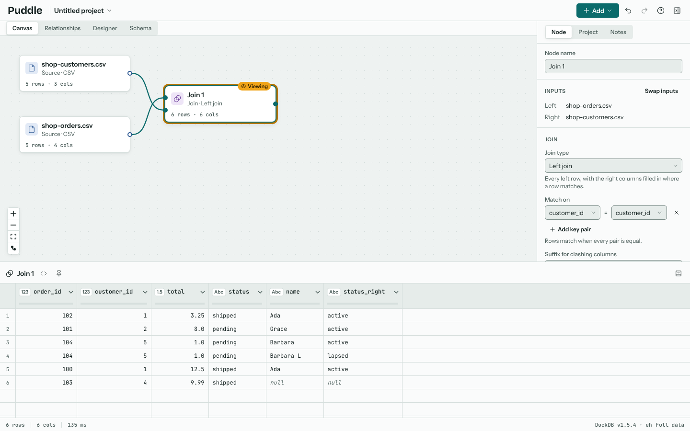
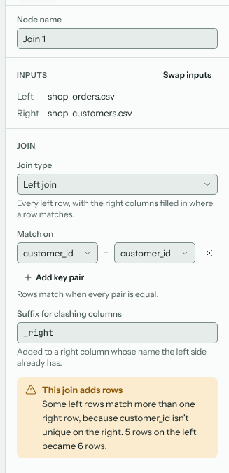
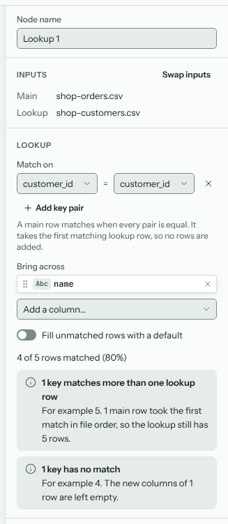
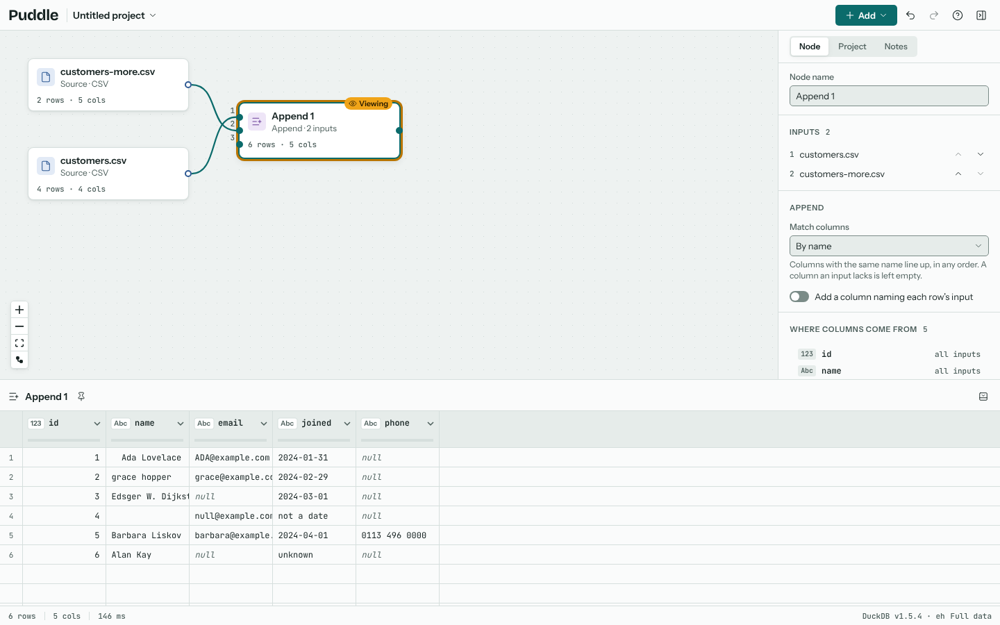

# Combining data

Puddle has three nodes for bringing data together. Each takes its inputs from the nodes wired into it. The quickest way to make one is to select its inputs on the canvas (click the first, Shift+click the next) and choose from the selection bar or the **Add** menu. The order you select them in is the order they're wired.

## Join

A Join puts two inputs side by side, matching rows on key columns, like a SQL join. It has a left input and a right input.

In the inspector:

- **Join type** chooses which rows to keep: a left, inner, right or full join, an anti join (left rows with no match) or a semi join (left rows with a match, without the right's columns).
- **Match on** pairs a left column with a right column. Puddle starts with the keys of a relationship between the two inputs, if the project has one (see {doc}`relationships`), else a column the two share. **Add key pair** matches on several columns at once.
- **Suffix for clashing columns** is added to a right column whose name the left already has.
- **Swap inputs** exchanges left and right.

When a key repeats on the right, a left row matches more than once and the join has more rows than its left input. Puddle says so ("5 rows on the left became 6 rows"), because it's usually a sign of a duplicate you didn't expect.

## Lookup

A Lookup brings columns across from a second input onto the first, like `VLOOKUP` or `XLOOKUP` in a spreadsheet. Unlike a join it always keeps every row of the main input exactly once: when a key matches more than one lookup row, the first is used.

The inspector shows how many rows found a match, and explains keys that are missing from the lookup or appear in it more than once.

## Append

An Append stacks the rows of two or more inputs, one after the other, like `UNION ALL`. Columns are matched by name (or by position, if you choose). A column that only some inputs have is filled in as empty for the others, and the inspector lists where each column comes from. Optionally, Append adds a column naming each row's input.

Wire more inputs into the spare numbered input on the node to append more.
