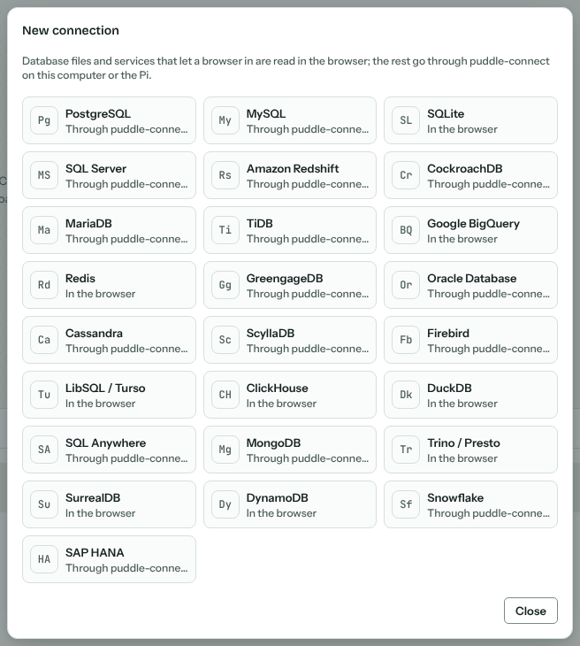
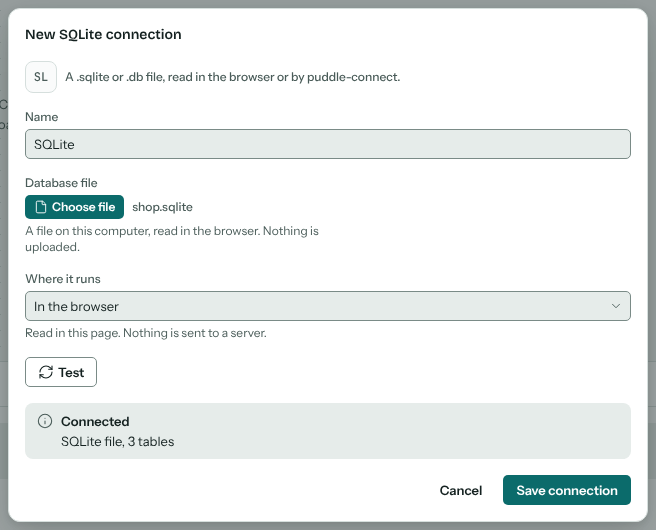
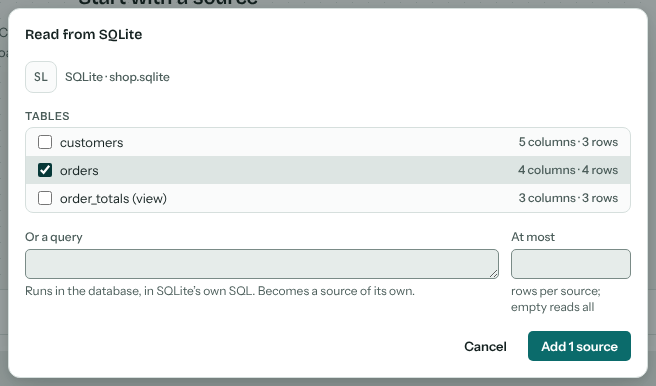
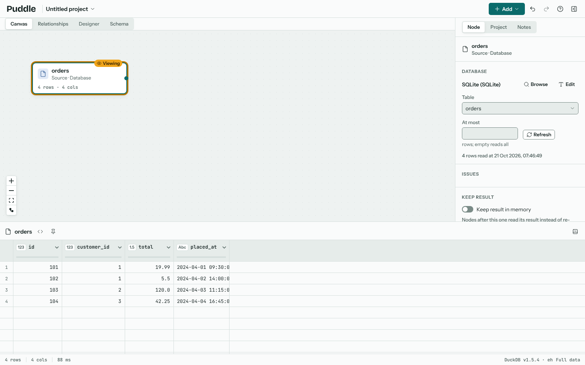
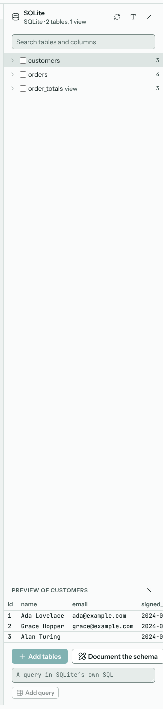
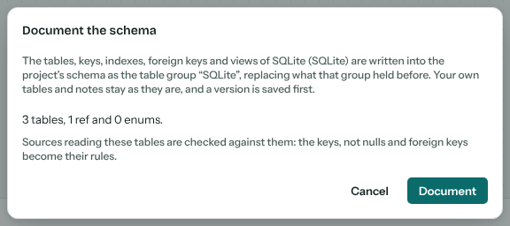
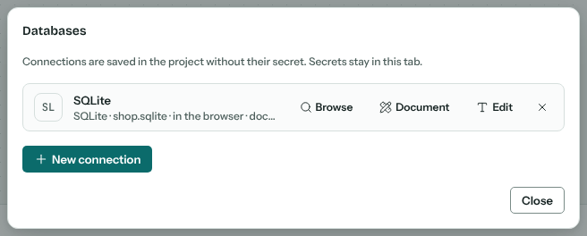

# Databases

Puddle reads tables and queries from databases as sources, documents their schemas into the {doc}`schema` view, and keeps every connection in the project without its secret. This page covers the connection end to end: making one, where it runs, reading from it, browsing and documenting it, and what each of the 25 databases on the grid gives. The {ref}`Databases <sources-databases>` section of {doc}`sources` has the per-database detail of the fields and types.

## Connections

**Add › From database** (shortcut: D) lists the project's saved connections, with **Browse** and **Read from** on each, and **New connection** opens the grid of databases. Pick one and its form asks for what that database needs: a file for the file databases, otherwise the address, the database and the user name, the database's own fields (a keyspace, a warehouse, a region) and the secret.

**Test** opens the connection and says what answered: the server's version, or how many tables a file has, or why it couldn't. **Save connection** keeps the connection in the project; a saved connection can be edited later from the list, or from **Edit** on a source that reads it.

### Where it runs

A browser can open some databases itself and not others, so each connection says where it runs under **Where it runs**:

In the browser
: Database files (SQLite, DuckDB, a LibSQL file) are read in the page, as any file is; nothing is uploaded. Services with an HTTP interface that lets a browser in (ClickHouse, Trino, BigQuery, Turso, SurrealDB, DynamoDB, an Upstash Redis) are read straight from it.

On this computer
: Through **puddle-connect** running on your own computer, next to the database: `npx puddle-connect --origin https://puddle.kevspowertools.com`. Puddle finds it at `localhost:8765`. It needs no token there and reads database files under the folder it was started in.

On the Pi
: Through puddle-connect running behind the site, started with `docker compose --profile connect up -d`. It asks for its token once and keeps it in the tab. The service reaches only the hosts it is allowed (`PUDDLE_CONNECT_ALLOW`), and Cloudflare Access on its path asks for your login before the token is even checked. The [deployment guide](https://github.com/kevinmcaleer/puddle/blob/main/deploy/README.md#databases-puddle-connect) has the settings.

puddle-connect is not a proxy: it has no route that fetches a URL, only drivers that open databases. Each request carries the connection's settings and secret and nothing is kept between requests; it opens read-only sessions where the database has them and refuses a statement that writes where it doesn't, bounds each read with a timeout and a row cap, and logs the route, driver and host, never a secret or a row.

### Secrets

A password, token or key is typed into the connection form and kept for this tab only: never in the project, its file, a recipe, a shared link or a sync. With **Keep for this tab** on, the tab remembers it until the tab is closed, so the sources read again after a reload; off, it is used for the test and the save and then forgotten. When the project is opened in another tab, or shared, its connection sources show **Sign in to the database in the inspector**, and the inspector's **Sign in** takes the secret again. A connection whose server asks for no password (a local MongoDB, a Redis without one) signs in with an empty one.

To forget a secret, close the tab, or edit the connection and save it with **Keep for this tab** off. Removing a connection under **Project › Databases** forgets it too.

On the runner the secrets come from its environment instead: the variable `PUDDLE_SECRET_<NAME>` or the file `PUDDLE_SECRETS` names; a project file that carries a secret is refused. See {doc}`self-hosting`.

## Reading a table or a query

**Read from** on a saved connection lists the database's tables and views with their columns and sizes. Tick the tables to read, or write a query in the database's own language, and set **At most** rows to read (empty reads them all). Each table and the query becomes a source on the canvas, named after the table, read through the connection with the types the database declares.

A connection source's inspector shows its table or query and the row limit; change either and the rows are read again, and **Refresh** reads them again as they are now. Some databases take more there: a **Filter** or **Where** condition in the database's own terms (MongoDB, Cassandra), how deep nested documents are opened and whether arrays become rows (the document stores). The rows are loaded into Puddle's engine once and every step below works on them there, so a step never sends a query back to the database.

## The database browser

**Browse**, on a connection in the list or in a connection source's inspector, opens the database browser in the inspector's place: the schemas, tables and views with their columns and types, a search over table and column names, a row estimate per table where the database has one cheaply, and a preview of a table's first 100 rows when its name is clicked. Tick tables and **Add N tables** makes a source of each (or drag a table onto the canvas); a query typed in the box becomes a source with **Add query**. **Refresh** reads the catalogue again.

## Documenting a schema

**Document the schema** in the browser (or **Document N tables**, with some ticked), and on each connection under **Project › Databases**, reads what the database says about itself: its tables and columns with their types, keys, defaults and not nulls, indexes, foreign keys, enums, and views with their SQL. The dialog says what it will write before it writes it.

The result lands in the {doc}`schema` view as a table group named after the connection, beside your own tables and notes, which stay as they are; foreign keys become refs, enums become enums, and a view is a note holding its SQL. A database that keeps no catalogue of columns (MongoDB, DynamoDB, Redis, SurrealDB) is inferred from a sample of its records instead, and the group's note says from how many. Documenting again replaces what the group held and shows what changed since the last time, and each documenting saves a version labelled with the connection and the day.

A source that reads a documented table is checked against it: its primary key, foreign keys and not nulls become rules in the source's inspector, and the {doc}`relationships` view draws the documented refs between sources read from the same database, each marked **Ref in the schema**.

## Project › Databases

**Project › Databases** lists the project's connections with where each runs, when its schema was last documented, and **Browse**, **Document** and **Edit** on each. A connection is removed from there too, which also forgets its secret; sources that read it then say so. **Home › Connections** lists the connections across projects, so a new project can copy one.

## What each database gives

| Database | Where it runs | What the catalogue gives | Notes |
| --- | --- | --- | --- |
| PostgreSQL | Service | Every schema but the system ones; keys, indexes, foreign keys, comments, enums, views | A read-only session. **Use SSL** and **Check the certificate** for TLS. |
| MySQL | Service | The connection's database; keys, indexes, foreign keys, comments, `ENUM` columns as enums | `TINYINT(1)` as a boolean; `TIME` kept as text. |
| SQLite | Browser, or service | Tables and views from `PRAGMA`; keys, indexes, foreign keys | A file chosen in the page, or its path on the computer running the service. The runner finds it by name beside the project. |
| SQL Server | Service | `sys.*`; keys, indexes, foreign keys, extended properties as notes | A SQL login, a Windows login (**Domain**) or an Entra ID token. Read-only intent. |
| Amazon Redshift | Service | As PostgreSQL | SSL on by default. |
| CockroachDB | Service | As PostgreSQL | SSL on by default. |
| MariaDB | Service | As MySQL | |
| TiDB | Service | As MySQL | SSL on by default. |
| Google BigQuery | Browser, or service | The dataset's `INFORMATION_SCHEMA`; keys, descriptions, defaults | A service-account JSON key as the secret, exchanged for a token that can only read. `ARRAY` and `STRUCT` as JSON text. |
| Redis | Browser (Upstash REST), or service | Keys grouped by prefix as tables; the columns a prefix's keys show | A hash's fields as columns, a list or set one row per member; `SCAN`, never `KEYS`; reading commands only. |
| GreengageDB | Service | As PostgreSQL | |
| Oracle Database | Service | The user's own schema; keys, indexes, foreign keys, comments, views | Named by **Service name**. `NUMBER` held by precision and scale; `DATE` as a timestamp. |
| Cassandra | Service | `system_schema`: tables, materialized views, partition and clustering keys, indexes | A **Where** condition in CQL; a condition off the keys needs **Allow filtering**, which scans the table. |
| ScyllaDB | Service | As Cassandra | |
| Firebird | Service | `RDB$` tables; keys, indexes, foreign keys | The **Database path** on the server; an optional **Role**. |
| LibSQL / Turso | Browser, or service | As SQLite | Turso over HTTPS with its token, or a local file read like SQLite. Reads are rolled back. |
| ClickHouse | Browser, or service | Tables with the primary key, comments, defaults and skipping indexes | Read straight from its HTTP interface; `Array`, `Tuple`, `Map` and `Nested` as JSON text. |
| DuckDB | Browser | `duckdb_tables()` and `duckdb_columns()`; constraints | A `.duckdb` file attached read-only, so its views read as they are. Not read by the runner yet. |
| SQL Anywhere | Pi | Not read yet | SAP's client isn't available for the Pi; a connection can be kept for later. |
| MongoDB | Service | Inferred from a sample of each collection's documents; views with their pipeline | A **Filter** document; a query as the shell writes it; `$out` and `$merge` refused. Nested documents flattened, arrays as JSON text or one row each. |
| Trino / Presto | Browser, or service | `information_schema` of the catalog and schema | No keys to document. Read in the browser where the cluster's CORS setting lets this site in. |
| SurrealDB | Browser, or service | Declared fields plus the fields a sample of records shows; record links as refs | A query that writes is refused before it is sent; give the user the VIEWER role. |
| DynamoDB | Browser, or service | Key schema and indexes from `DescribeTable`; columns from a sample of items | A table is read with a scan, page by page to the row limit, which costs read units; a query is a PartiQL `SELECT`. An **Endpoint** only for DynamoDB Local. |
| Snowflake | Service | `information_schema`; keys, comments, views | A key pair: the private key (PKCS#8 PEM) as the secret. No read-only session, so give the user a read-only role. |
| SAP HANA | Service | The SYS views of the user's current schema; keys, defaults, comments, indexes | SAP's own client through the service; **Tenant database** empty for the system database. |

*Service* is puddle-connect, on this computer or on the Pi. The runner (`puddle-run`) reads every database the service does, in-process, and the file databases by their path; it can't attach a DuckDB file or sign in through the browser.
