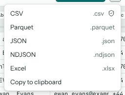
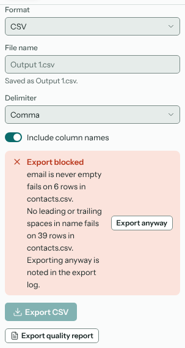
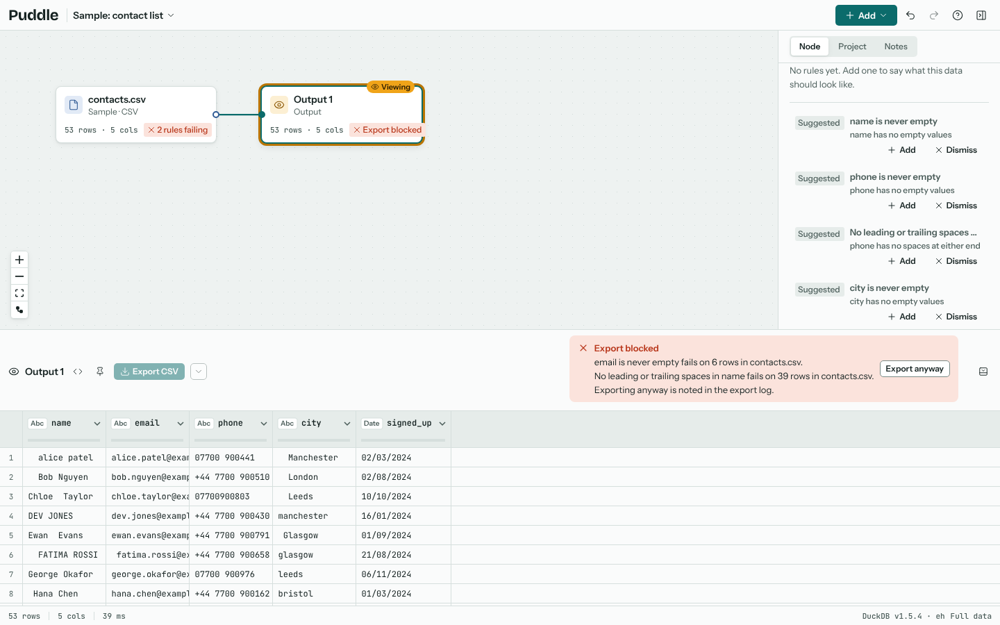
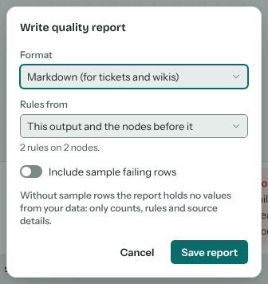

# Exporting

An Output node marks data that's ready. Select the node it should follow and choose **Output** from **Add** (or press O). Its export button sits in the results bar, and its settings in the inspector.

The button exports in the node's format, CSV to begin with. To export as Parquet, Excel, JSON or anything else, open the menu beside it (the arrow next to **Export CSV**) and pick a format: the node switches to that format and exports straight away, and the button then says, for example, **Export Parquet**. You can also change the **Format** in the inspector.

## Formats

| Format | Settings |
| --- | --- |
| CSV | The delimiter (comma, semicolon, tab or pipe) and whether to include column names. |
| Excel | The sheet name, whether to include column names and freeze the header row. |
| JSON | An array of objects. |
| NDJSON | One object per line. |
| Parquet | The compression (zstd, snappy or none). Keeps each column's type and is much smaller than CSV, so it suits large outputs and other data tools. |
| Clipboard | Copies the rows as tab-separated text, ready to paste into a spreadsheet. |

The file is named after the node unless you give a **File name**. Exports run inside DuckDB in your browser and download straight from there; nothing is uploaded. They always use the full data, even when you've been editing on a sample.

**Export all**, in the project menu, runs every Output node in the project.

## The quality gate

When a *fail* rule fails anywhere before an Output node, the export is blocked: the node says so, and the results bar lists which rules fail and on how many rows.

Fix the data, change the rule to a warning, or choose **Export anyway**. Exporting anyway is allowed, but it's written in the node's export log with the rules it went past, so there's a record.

## Quality reports

**Export quality report**, in the Rules section of the inspector, writes up what the rules found: each rule's result and counts, any overrides from the export log, and every source with its row count and a fingerprint of the start of its file. Choose Markdown (for tickets and wikis), JSON, or one self-contained HTML page.

A report holds no values from your data unless you turn on **Include sample failing rows**, so it's safe to share.
