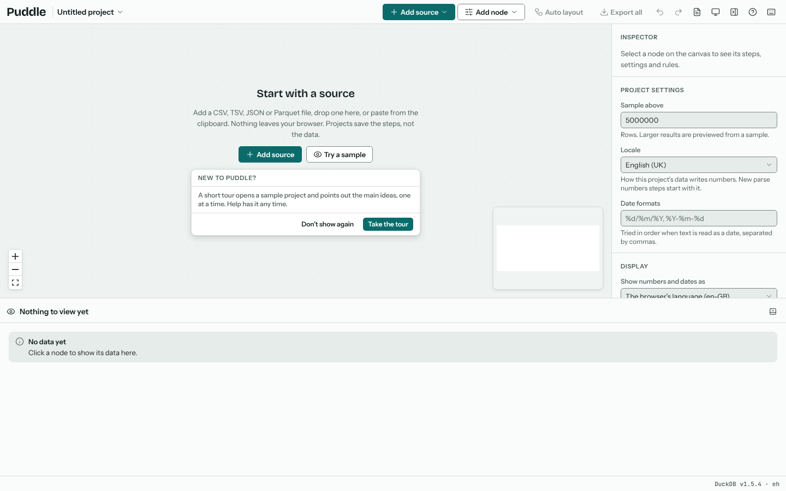
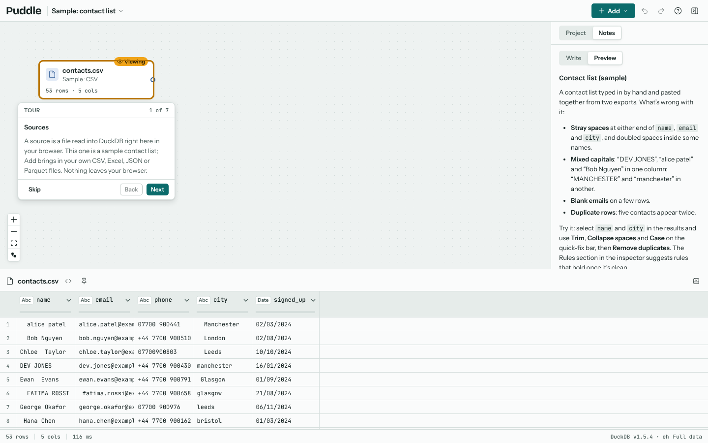
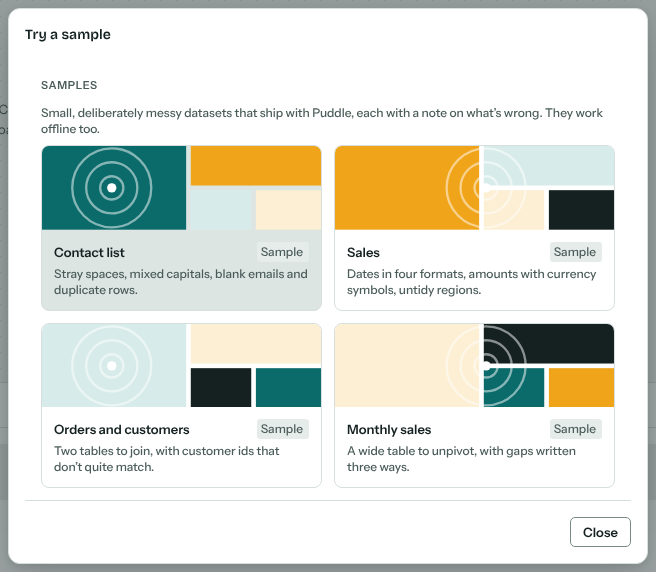
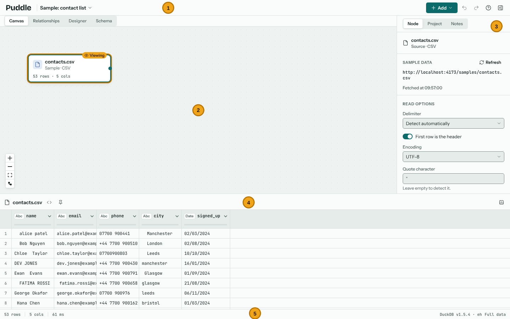

# Getting started

## Opening Puddle

Puddle is a web page. Open it in Chrome or Edge for the best experience (Firefox and Safari work too, but can't remember your files between visits). The first time it opens it starts DuckDB, which takes a moment; the status strip at the bottom right shows the DuckDB version once it's ready.

A new visit opens an empty project with two ways in: **Add source** for your own files, and **Try a sample** for a small messy dataset that ships with Puddle.

## The guided tour

On your first visit Puddle offers a short tour. It opens the contact list sample and points out the main ideas one at a time: sources, the canvas, the results table, quick fixes, steps, rules and the Output node. Some stops ask you to do something, such as selecting a column, and move on by themselves once you have.

You can leave the tour at any point with **Skip**, and pick it up again later from the **Help** menu in the toolbar. The same menu opens this guide (**User guide**).

## Samples

**Try a sample** opens one of eight deliberately messy datasets as a new project. Each comes with a project note saying what is wrong with the data and where to start, and the Issues panel lists what Puddle found (see {doc}`analysing`).

| Sample | What's wrong with it |
| --- | --- |
| Contact list | Stray spaces, mixed capitals, blank emails and duplicate rows. |
| Sales | Dates written four ways, amounts with currency symbols, untidy regions. |
| Orders and customers | Two tables to join, with customer ids that don't quite match. |
| Monthly sales | A wide table to unpivot, with gaps written three ways. |
| CRM export | A text export with comment lines, a footer, a header pasted in twice and ragged rows. |
| SAP extract | A report printed to text: banners, separator lines, a page break and a total row. |
| Skewed invoices | A spreadsheet where a cell was deleted part way down, so the rows below sit a column over. |
| Merged report | A report sheet: a title, a two-row header, regions merged down their stores, subtotals and footnotes. |

Samples are ordinary projects: change them as much as you like, and delete them from the projects list when you're done. They work offline too.

## The screen

1. **The toolbar.** The app switcher, which goes to Kev's other Power Tools; the Puddle wordmark, which goes back to all your projects; the project's name and menu, **Add** (sources and nodes), undo and redo, **Help** and the inspector toggle.
2. **The canvas.** Your flow: sources on the left feed transforms, joins and other nodes, which feed outputs on the right. See {doc}`canvas`.
3. **The inspector.** Its **Node** tab has everything about the selected node: a source's read options, a transform's steps and their settings, rules, and notes. The **Project** tab holds the project's settings, and the **Notes** tab the project's notes.
4. **The results.** The data at the node you're viewing, with each column's type and a bar showing how much of it is missing or unusual. Selecting columns here brings up the quick-fix bar.
5. **The status strip.** Row and column counts, how long the last query took, how the viewed node's rules are doing, and a profile of the selected column.

## Your first clean-up

With the contact list sample open:

1. Select the `name` column's header in the results, then Ctrl+click `city`.
2. Choose **Trim** on the quick-fix bar. Puddle adds a Transform node after the source with one step, "Trimmed name, city".
3. With the same columns selected, choose **Case**, then **Title Case**. That is a second Transform, wired after the first.
4. Click `name`, then Shift+click `signed_up` to select every column, and choose **Remove duplicates**.

Every click added a step, each a node on the canvas, that you can see, change, turn off or delete in the inspector. Puddle had found the same problems itself: the **Issues** panel in the inspector lists them, and **Fix all** applies every fix in one go (see {doc}`analysing`). Carry on with {doc}`cleaning`.
