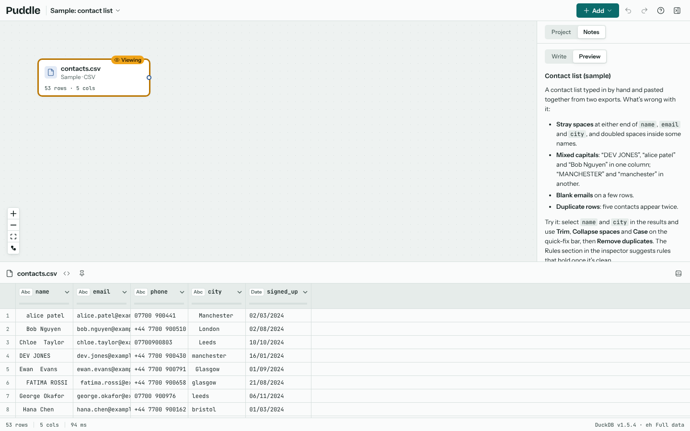

# Puddle

Puddle turns messy data into tidy data in your browser. Load a file, wire a flow of cleaning steps on a canvas, check the result against quality rules and export it, in the spirit of Power Query.

Everything runs on your own machine. Puddle reads your files with [DuckDB](https://duckdb.org) compiled to WebAssembly, so no data is uploaded anywhere, and large files work because they are read from disk in pieces. A project saves the steps, notes and settings, never the data.



## Where to start

New to Puddle? Read {doc}`getting-started`, which opens a sample and walks through the screen. Then {doc}`cleaning` covers the one-click fixes that do most of the work, and {doc}`tutorial-taxi` puts it all together on three million real taxi trips.

```{toctree}
:maxdepth: 2
:caption: Using Puddle

getting-started
sources
canvas
cleaning
combining
query-designer
relationships
schema
schema-dbml
reshaping
quality-rules
exporting
projects
settings
```

```{toctree}
:maxdepth: 2
:caption: Tutorials

tutorial-taxi
```

```{toctree}
:maxdepth: 2
:caption: Reference

step-reference
self-hosting
about-these-docs
```
