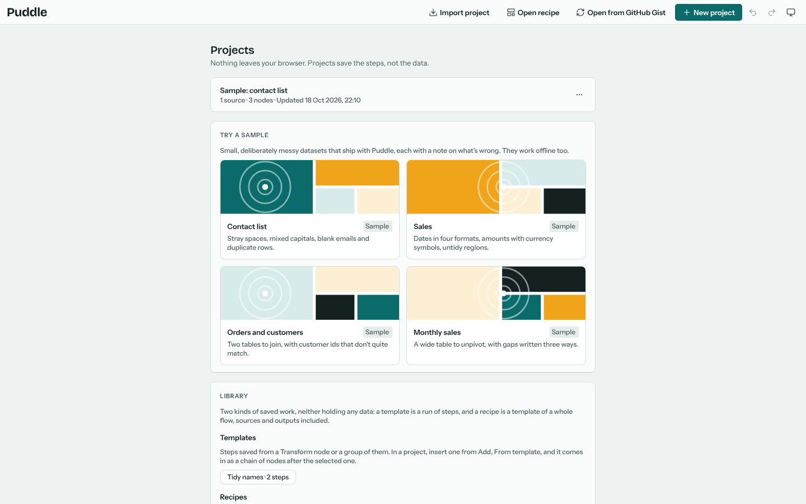
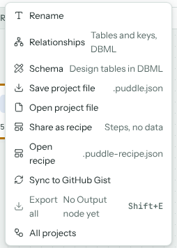
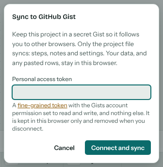
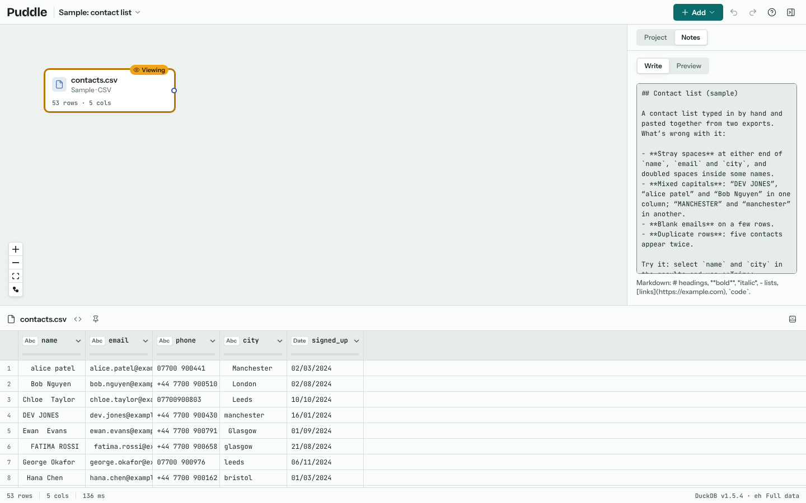
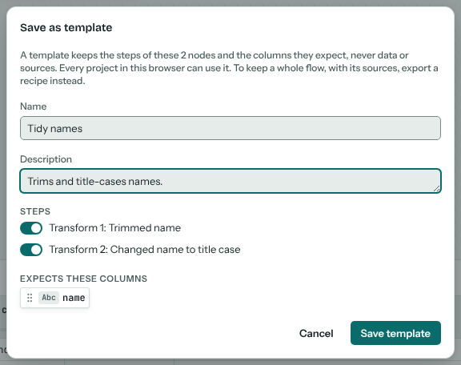
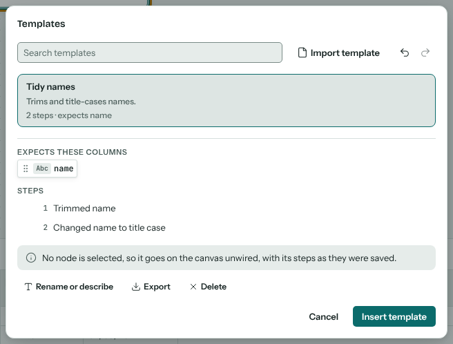
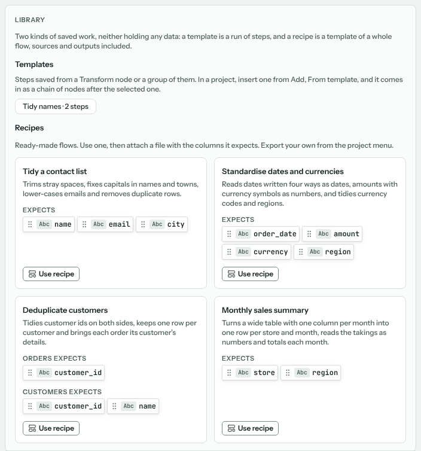
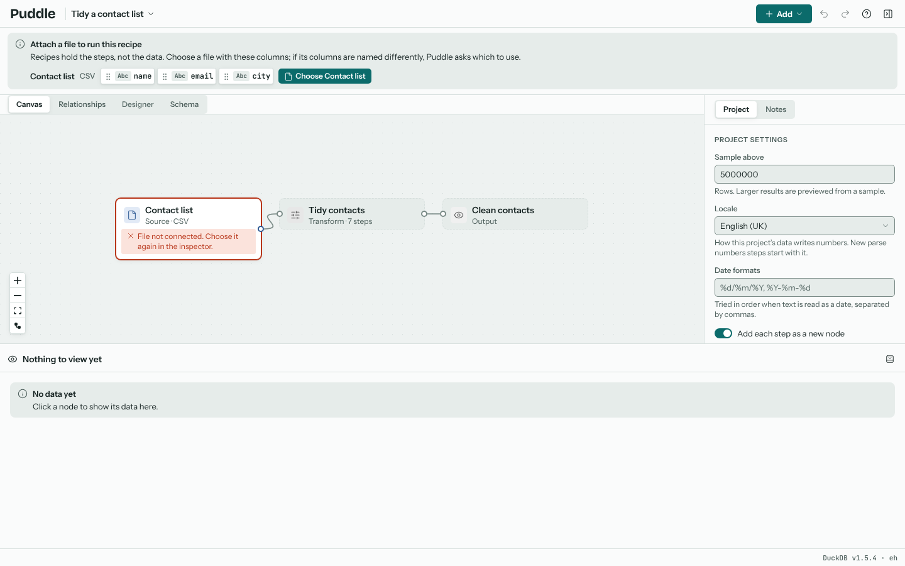

# Projects

A project is your flow: its sources (how to read them, not their data), nodes, steps, rules, notes and settings. Puddle saves it in your browser as you work, so there's no save button.

## The projects list

**All projects**, in the project menu (click the project's name in the toolbar), opens the home screen: your projects, newest first, with the samples and the library (your templates and the recipes) below. **New project** starts an empty one, and each project's **...** menu renames, duplicates or deletes it. Undo on this screen brings back a project deleted by mistake (see [Undo and redo](#undo-and-redo)).

The project menu also renames the open project, and exports and imports projects and recipes.

## Undo and redo

Every change you make can be undone: **Undo** and **Redo** in the toolbar, or Ctrl+Z to undo and Ctrl+Shift+Z or Ctrl+Y to redo (Cmd on a Mac). Hold the keys to step back through several changes.

- **In a project**, undo covers everything you change: adding sources and nodes, wiring, moving and grouping nodes, steps and their settings, read options, rules, the query designer, notes, renaming, and the column mapping for a recipe. One action is one undo step, so several files chosen or dropped together come off with one undo. The keys work from the canvas and from a field you've just changed, such as a drop-down or a switch; in a text box you're still typing in, they undo the typing first.
- **On the projects screen**, undo brings back a deleted project (with its saved file access and its sync), and undoes renaming or duplicating one.
- **In the templates library**, the undo and redo buttons beside **Import template** (or the keys) undo adding, importing, renaming and deleting templates.

A few things aren't undo steps, because they record what happened rather than change your work: exports (the export history), which file a source is attached to, and moving around the canvas or changing what the results show. Undoing never takes a source back to a file it no longer reads. When sync brings in a newer version of the open project from another browser, that is an undo step too, so undo returns to the version you had.

The undo history lasts while the tab is open. Projects themselves are saved as you go.

## Moving projects between browsers

Projects live in this browser's storage. To move one, or keep a backup, choose **Export project**: it downloads a `.puddle.json` file with the steps, notes and settings (and any pasted rows), but no file data. **Import project** opens one again.

To have a project follow you from browser to browser automatically, sync it:

GitHub Gist
: **Sync to GitHub Gist** keeps the project in a secret Gist. It needs a fine-grained personal access token with the Gists permission only; the token stays in this browser. **Open from GitHub Gist** on the home screen brings a synced project into another browser.

Google Drive
: Where the site has been set up with a Google client ID, **Sync to Google Drive** keeps the project in a Puddle folder in your Drive. Puddle can see only the files it makes there, and keeps the sign-in for an hour at most.

Sync only ever sends the project file: steps, notes and settings. Your data, and any pasted rows, stay in this browser. If the same project changes in two places, Puddle asks which to keep.

## Notes

The **Notes** tab in the inspector holds the project's notes: Markdown you write about the project, such as where the files come from or what each step is for. **Preview** shows it formatted. Each node has its own notes too, in the inspector.

## The library

The library holds two kinds of saved work, neither with any data in it. A **template** is a run of steps, saved from a Transform node or a group of them. A **recipe** is a template of a whole flow: its sources (as the columns they expect), steps, rules and outputs. The home screen lists your templates and the built-in recipes together.

### Templates

To save a template, right-click a Transform and choose **Group the chain**, then right-click the group and choose **Save as template**; a single Transform has **Save as template** in the inspector, which takes the chain it is in. Pick the steps to keep. The template remembers which columns its steps read.

To use one, select the node it should follow and choose **From template** in **Add**. The library shows each template's steps and the columns it expects. When the input calls a column something else, choose which column to use instead; steps whose columns are missing are turned off rather than failing. The template comes in as a chain of one-step Transform nodes, wired after the selected node and gathered into a group named after the template, just as if you had added the steps yourself (with **Add each step as a new node** off, it comes in as one Transform). Templates can be exported and imported as files too.

### Recipes

A recipe is a template of a whole pipeline. Share one with a colleague, or keep one for a job you do every month. **Export recipe** in the project menu saves the open project as a `.puddle-recipe.json`, leaving out rows, file names, pasted data and anything else private.

The library on the home screen has a few recipes to start from.

**Use recipe** (or **Open recipe** for a file) makes a new project from it, and asks you to attach a file for each source. Choose a file with the columns it expects and the project runs; if the columns are named differently, Puddle asks which to use.

