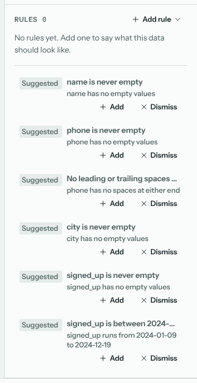
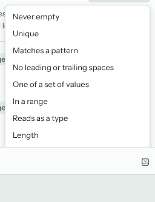
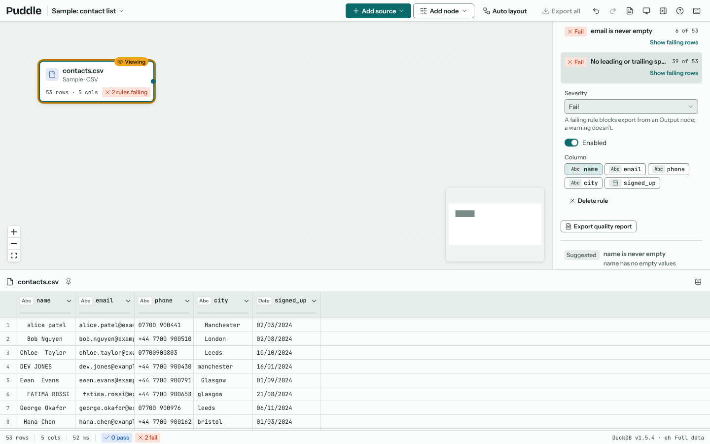
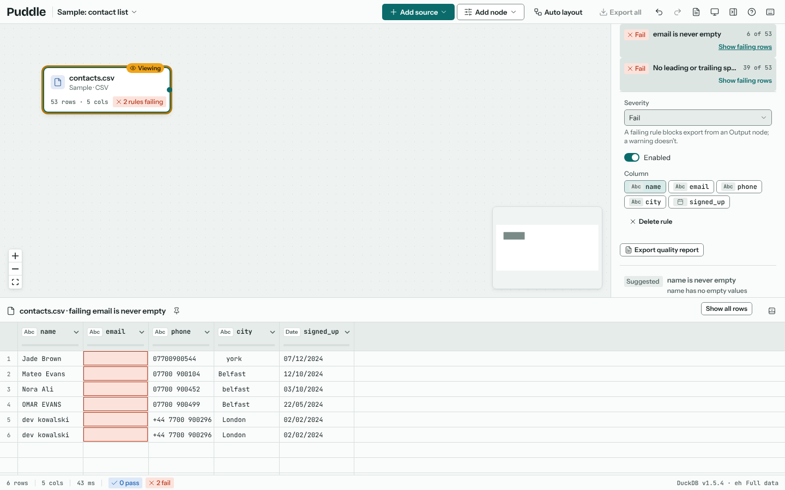
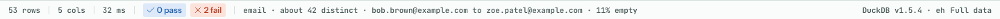

# Quality rules

Rules say what the data at a node should look like, such as "email is never empty" or "id is unique". Puddle checks them every time the data changes, shows how many rows fail, and can hold back an export until they pass.

## Suggested rules

Select a node and open the **Rules** section of the inspector. Puddle profiles the data and suggests rules that already hold, each with its reason: "name has no empty values", "signed_up runs from 2024-01-09 to 2024-12-19". **Add** turns a suggestion into a rule, so you'll hear about it if a later file breaks it. **Dismiss** hides a suggestion for good.

## Adding a rule

**Add rule** lists every kind of rule.

| Rule | Passes when |
| --- | --- |
| Never empty | The column has no empty values. |
| Unique | No value repeats. Pick several columns to check them together. |
| Matches a pattern | Every value looks like an email address, a web address, a UK postcode, a phone number, digits only, letters and digits only, or a regular expression of your own. |
| No leading or trailing spaces | No value starts or ends with a space. |
| One of a set of values | Every value is in a list you type, or among the values of a column of another node. |
| In a range | Every value is between a lowest and a highest number or date. |
| Reads as a type | Every value reads as a number, whole number, decimal, date, or true or false. |
| Length | Every value has exactly, at least or at most a number of characters. |
| Exists in another node | Every value is found in a column of another node, such as every order's customer in the customers table. |
| Custom expression | Every row satisfies a DuckDB condition, such as `total >= 0 AND status <> 'void'`. |
| Row count | The node has at least a number of rows, or the same number as another node. |

Each rule has a **Severity**. A failing *fail* rule blocks exports from Output nodes after it (until you choose to export anyway). A *warning* is shown but doesn't block.

## Seeing what fails

A rule shows whether it passes and how many rows fail ("6 of 53"). The node on the canvas gets a badge ("2 rules failing"), and the status strip counts passes and failures for the node you're viewing.

**Show failing rows** filters the results to just the rows that break the rule, with the column it checks highlighted. **Show all rows** goes back.

## Column profiles

Select a column in the results and the status strip profiles it: about how many distinct values it has, its range, and how much of it is empty. Every column header also has a bar showing the share of missing and unusual values at a glance.

