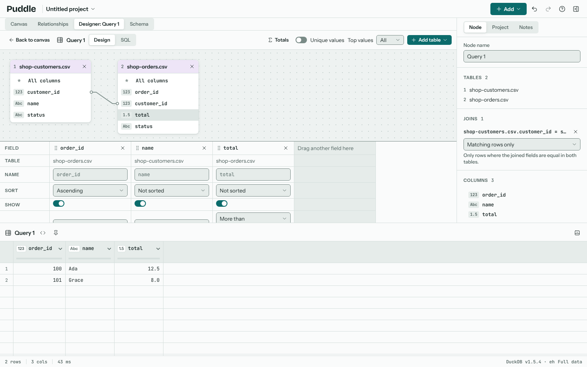
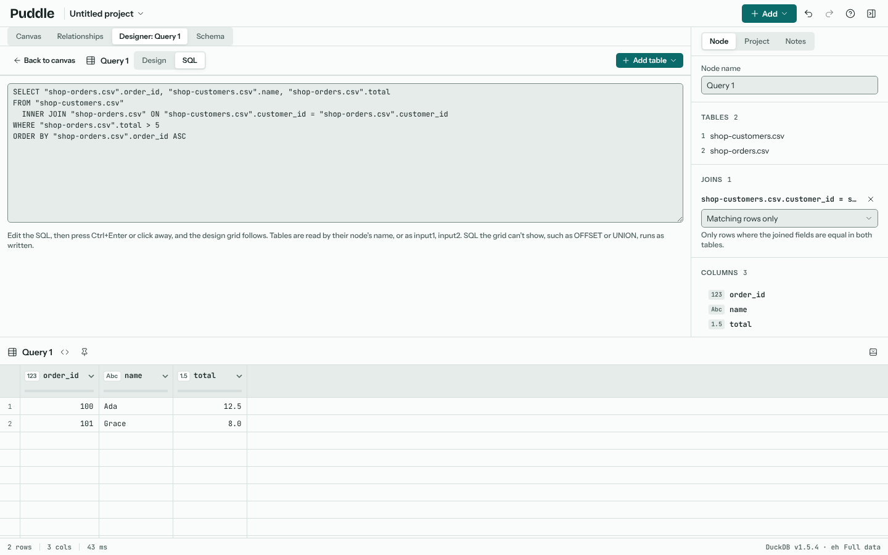

# The query designer

A Query node is for those who like Microsoft Access's query designer: put tables on a design surface, drag a field onto another to join them, and build the result in a grid of fields with sorting and criteria.

To make one, select the tables on the canvas and choose **Query these** on the selection bar, or **Query** from **Add**. The designer opens in place of the canvas, and the tabs above it (**Canvas**, **Relationships**, **Designer**, **Schema**) move between them, as do the keys 1, 2, 3 and 4; **Back to canvas** returns too. Selecting the Query node later and pressing Enter opens it again.

## Tables and joins

Each table shows its fields with their types. Drag a field onto a field of another table to join them: a line connects the two. The inspector lists the joins, and for each one which rows it keeps (matching rows only, every row of the first table, or every row of the second). Tables with no join line would pair every row with every row, and the designer warns about it. **Add table** brings in another node.

## The grid

Drag a field into the grid, or double-click it, to add it to the result. For each field you can set:

| Row | What it does |
| --- | --- |
| Name | The column's name in the result. |
| Sort | Ascending, descending or not sorted. Fields sort from left to right. |
| Show | Whether the field is in the result. A hidden field can still sort or filter. |
| Criteria | A condition on the field, such as "More than 5". Criteria on one row must all hold; each further "or" row is an alternative. |

**Totals** adds a Total row for grouping and summarising, as in Access: each field is Group by, or a summary such as Sum, Average, Min, Max, Count, Count distinct, First, Last, StDev or Var. Where filters on a field before grouping, and Expression takes a calculation over the others. **Unique values** removes repeated rows from the result. **Top values** keeps only the first 5, 10, 25 or more rows, after sorting, as in Access; All keeps every row.

## SQL view

As in Access, the designer turns the query into SQL and back again. Choose **SQL** at the top of the designer to see the design written as a DuckDB query, and **Design** to return to the grid.

You can edit the SQL. Press Ctrl+Enter, or click away, and the design follows: tables, join lines, fields, names, sorting, criteria and totals all fill in from the SQL. Tables are read by their node's name (in double quotes when it has spaces or dots), or as input1, input2 by number. Each table can have a short name of its own, such as `FROM orders o`, and a column only needs its table when two tables have it.

The grid can show:

- `SELECT` of fields, `*`, `DISTINCT`, and new names with `AS`
- `JOIN`, `LEFT JOIN`, `RIGHT JOIN`, `FULL JOIN` and `CROSS JOIN`, on fields that are equal
- `WHERE` and `HAVING` conditions such as `total > 5`, `name ILIKE '%ada%'`, joined with `AND` and `OR`; a condition on a field the query doesn't show goes on a hidden field, as in Access
- `GROUP BY` with `sum`, `avg`, `min`, `max`, `count`, `count(DISTINCT ...)`, `first`, `last`, `stddev` and `variance`, and other calculations over them as an Expression
- `ORDER BY`
- `LIMIT` with a number of rows, as Top values

Some SQL has no place in the grid: `OFFSET`, `UNION`, subqueries, `CASE` and the like. Puddle says why, and keeps your SQL: the query runs it as written, and **Design** is unavailable until you choose **Back to the design**, which discards the SQL and brings back the design as it was.
