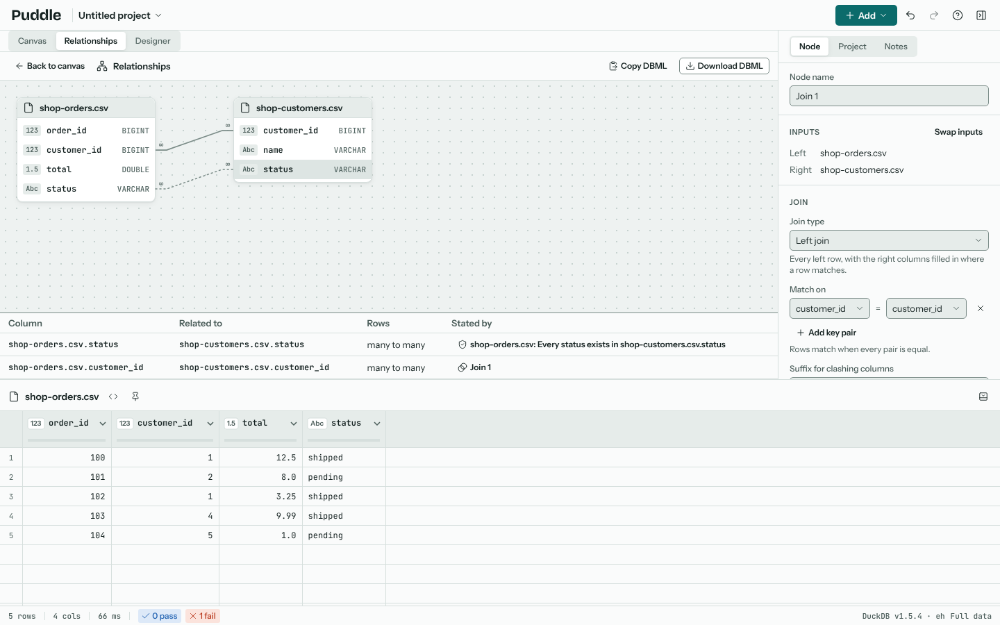

# Relationships

**Relationships**, in the project menu, shows how the project's tables relate, as in Microsoft Access's Relationships window: each table with its columns and their types, and a line between the columns that match. **Back to canvas** returns.

## Where relationships come from

Puddle draws the relationships the project already states:

- the keys of each Join and Lookup node,
- the join lines of each Query node,
- each "Exists in another node" rule, and each "Is one of" rule that takes its values from another node. These are drawn dashed: they check the data, they don't combine it.

Every source is drawn as a table. A key read from a Transform node is drawn on the source it comes from, as long as the column keeps its name on the way; a column a step made stays on the node that made it. The list below the tables names each relationship and where it's stated: click a name to open that node, or a Query's designer.

## One and many

Puddle checks each key column for repeated values, as the node that states the relationship reads it, and marks the line's ends: **1** where no value repeats, **∞** where some do. The list says the same in words, such as "many to one" for orders that each belong to one customer. A key column with no repeats is marked **key** in its table.

## Drawing a relationship

Drag a column onto the matching column of another table, or press Enter on a column and pick one. Puddle adds an "Exists in another node" rule to the first column's table, so the relationship is saved with the project and checked like any other rule (see {doc}`quality-rules`). Remove the rule in the inspector to remove the relationship. Drag a table's header, or focus it and use the arrow keys, to move it.

## DBML

**Copy DBML** and **Download DBML** write the tables and relationships as [DBML](https://dbml.dbdiagram.io), which tools such as dbdiagram.io draw as a diagram: a `Table` for each table with its columns and DuckDB types, and a `Ref` for each relationship, many-to-one (`>`), one-to-many (`<`), one-to-one (`-`) or many-to-many (`<>`) as the checks found. A column that is the "one" end of a relationship is marked `[unique]`.

**Open in Schema** writes the same DBML into the project's schema, adding it to what is there or replacing it, and opens the Schema view, where you can carry on designing the tables, export them as SQL and load data into them. See {doc}`schema`.
