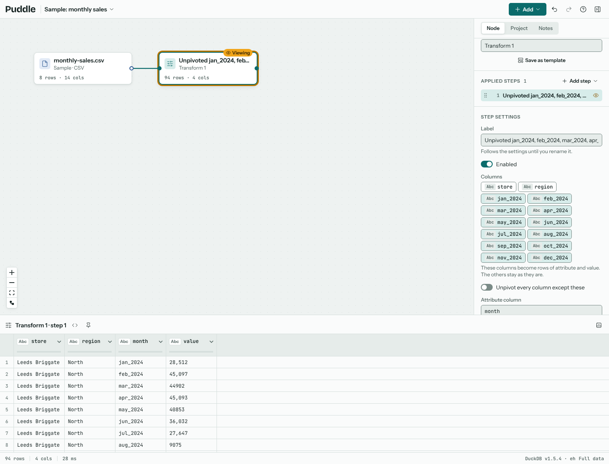
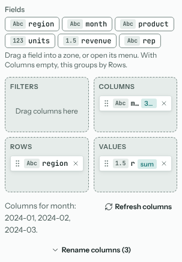
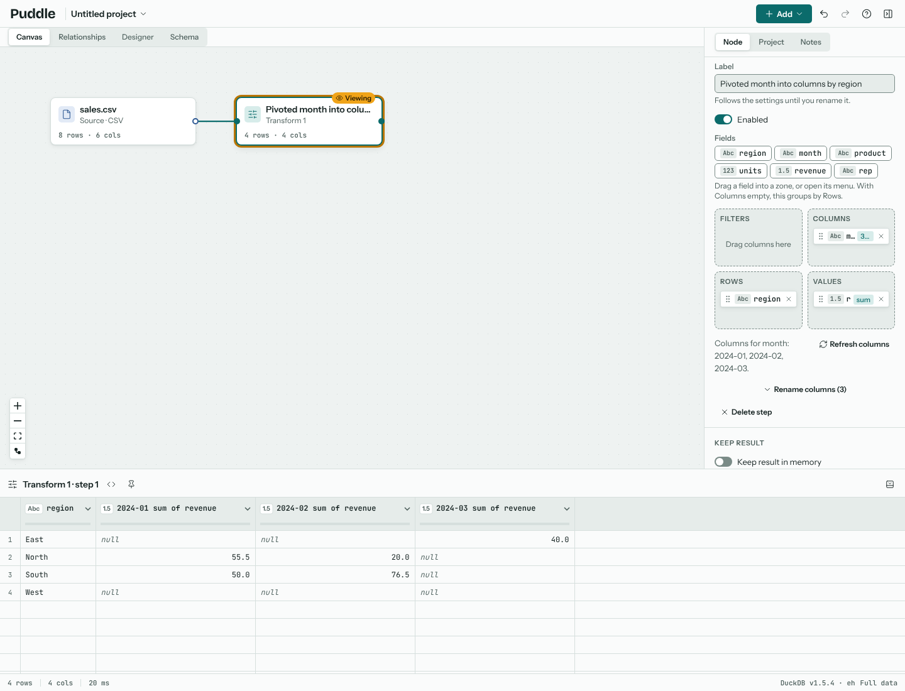

# Reshaping

Three steps change the shape of a table rather than its values: unpivot, pivot and transpose. Add them to a Transform node from the Reshape group of **Add step**.

## Unpivot: wide to long

A spreadsheet often has a column per month. Most analysis wants one row per store per month instead. **Unpivot columns** does that: pick the columns that should become rows, and each becomes a row with an attribute (the old column name) and a value.

Name the attribute and value columns in the step's settings. **Unpivot every column except these** is handy when new month columns appear each time the file is updated. When the chosen columns mix numbers and text, Puddle says which before it runs, and **Treat all values as text** unpivots them anyway.

## Pivot or group by

**Pivot or group by** summarises a table. Add it from **Add step**, or right-click a column in the results and choose **Group by this column** or **Pivot into columns** from the column menu: the step starts with that column in Rows or Columns, and a pivot starts by counting the rows under each value. Then drag columns from the field list into four zones:

Rows
: The columns to group by. Each distinct combination becomes a row.

Columns
: A column whose values become new columns (for a pivot). Leave it empty for a plain group by.

Values
: What to summarise, and how, from the field's menu: sum, count, count distinct, min, max, average, median, standard deviation, variance, first, last or list. A number starts as a sum and anything else as a count; click the aggregate on the field to change it. The same field can go into Values more than once, to show its sum and its average side by side.

Filters
: Columns to filter on before summarising.

A pivot's new columns are fixed when you set it up, so a later run with new values doesn't change the shape of the table under the steps after it. When the data gains a value (a new month, say), **Refresh columns** adds it and says what was added.

## Transpose

**Transpose** swaps rows and columns, for a small table written sideways. The first column can become the new column names.
