# Schema

**Schema**, in the project menu, is where you design tables before you have data for them, in the style of dbdiagram.io. You write the tables in [DBML](https://dbml.dbdiagram.io) on the left and Puddle draws them on the right as you type. The design is saved with the project, and it can become real DuckDB tables that your data loads into and is checked against. **Back to canvas** returns.

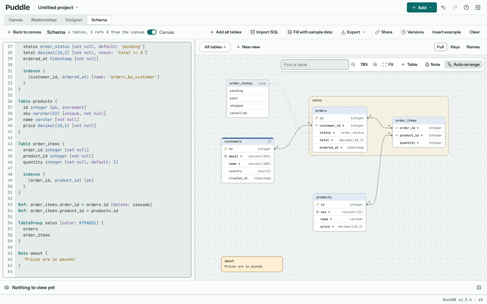

The Schema view also documents the project as it is: every table, query and view on the canvas, with the relationships between them, as Access documents a database (see [The canvas in the schema](#the-canvas-in-the-schema)).

The toolbar says how many tables and refs the text holds, and how many tables come from the canvas. **Insert example** writes a short example with a comment on each line, which is a good place to start; **Clear** empties the editor. The divider between the editor and the diagram can be dragged, or moved with the arrow keys.

{doc}`schema-dbml` lists the DBML that Puddle reads.

## The editor

The editor colours DBML as you type, keeps the indent when you press Enter and closes braces. Ctrl+Space suggests what can come next, such as a column setting or a table name in a ref, and Ctrl+/ comments out the selected lines.

A mistake doesn't stop the diagram: the line is underlined, and a list under the editor says what is wrong, such as "The column "email" needs a type, such as varchar or integer". Click **Line** and its number to go to it. Everything else in the text is still drawn.

Each burst of typing is one step for **Undo**, and so is each edit made on the diagram, so the text and the diagram always go back together.

## The diagram

Each table is drawn as a box with its columns and types. A key icon marks the primary key, a link icon a column in a ref and a fingerprint a unique column; a not null column is in bold with a `*` after its name. Lines join the columns of each ref, with **1** at the "one" end and **∞** at the "many" end. Enums are drawn as boxes of their values, joined by a dotted line to the columns that use them; table groups as a shaded frame around their tables; sticky notes as notes.

Hover over a column to see its settings, default, note and, for an enum column, its values. Hovering over a table lights up its refs and dims the rest.

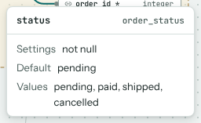

Hover over a table's header to see a sample of its data: the first rows of its Schema table node if the project has one, otherwise the records written in the DBML (see [Sample data](#sample-data)).

Click a table to show it in the DBML; Shift+click adds tables to the selection. Drag a table, a group or a note to move it, or focus it and use the arrow keys. The places you give them are saved with the project.

The bar above the diagram has:

- **Find a table**, which centres the table you type and highlights it,
- the zoom buttons, and the zoom level, which goes back to 100% when clicked,
- **Fit**, which fits the whole diagram in the pane,
- **Table** and **Note**, which add a new table or sticky note,
- **Auto-arrange**, which lays the tables out so nothing overlaps.

With the diagram focused, the arrow keys pan, + and - zoom, 0 shows it at 100% and Shift+1 fits it.

## The canvas in the schema

With **Canvas** on in the toolbar (it is, unless you turn it off), the diagram draws the canvas next to the DBML's tables, in three groups:

- **Canvas tables**: each source, with its columns and DuckDB types,
- **Canvas queries**: each Query, SQL, Join, Lookup and Append node, with the columns it gives,
- **Canvas views**: the last Transform of each chain of steps, which is its table as cleaned.

Lines join the columns of every relationship the project has, the same ones as the Relationships view (see {doc}`relationships`), with **1** and **∞** as Puddle checked them. Hover over a canvas table to see what it is (a source's file, a join's keys, a query's SQL or a view's steps) and the first rows of its data. Its menu opens it in the results, or a Query in the query designer.

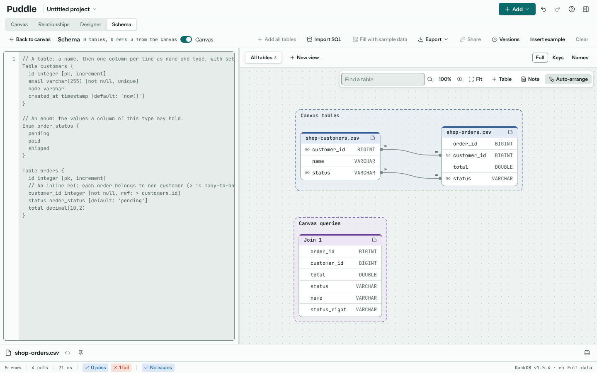

Canvas tables are drawn from the project as it is, so they can be moved but not edited here. A node with the name of a table written in the DBML is documented by that table instead, so writing a table into the DBML (with **Open in Schema** in the Relationships view, say) takes it over, and its relationships move with it. Schema table nodes are always their DBML table. The Docs, Image and Mermaid exports include the canvas's tables; the SQL export writes only the DBML's design.

## Editing on the diagram

Edits on the diagram change the DBML in place, keeping your comments and layout, and the editor shows the change.

- Double-click a table's header to rename it, or a column to rename that column. Refs to it follow. F2 does the same for the focused table.
- Right-click a table for its menu: **Rename…**, **Add column…**, **Add note…**, **Header colour**, **Group** (move it into a table group, or make a new group from the selected tables), **Fill with sample data…** and **Delete table**. If the project has a Schema table node for it, **Open in results** shows its rows.
- Right-click a column for its menu: rename it, change its **Type…** or **Default…**, add a column after it, switch **Primary key**, **Unique**, **Not null** and **Increment** on or off, or delete it.

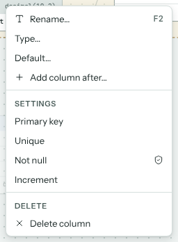

To add a ref, drag a column onto the matching column of another table. Puddle suggests the kind of ref from the keys at each end, such as many to one when the second column is a primary key, and asks whether either end may have no match. **Add ref** writes a `Ref:` line at the end of the text.

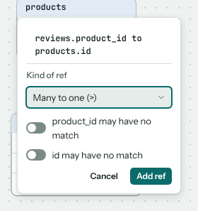

## Views and detail

A large schema is easier to read a part at a time. The strip above the diagram has a tab for **All tables** and one for each view you make. Shift+click some tables and click **New view of 2** (or however many you picked) to make a view of just those, with the refs between them. **Add tables…** adds more to the open view, and a table's menu has **Hide from view**. The **…** button beside a view's tab renames, duplicates or deletes it. Each view keeps its own layout and zoom.

**Full**, **Keys** and **Names** set how much each table shows: every column, only the keys and the columns in a ref, or only the table's name. Each view has its own level.

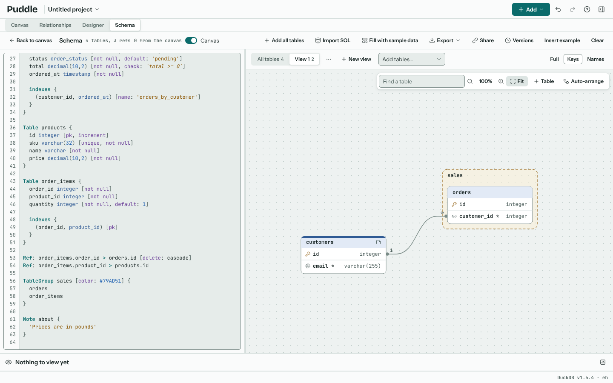

Views and detail levels change only the picture, never the DBML.

## Bringing a schema in

There are three ways to start from a schema you already have.

- **Paste DBML.** A file from dbdiagram.io, or any other DBML, can be pasted straight into the editor.
- **Import SQL.** Paste `CREATE TABLE` statements, or open a `.sql` file: a `pg_dump --schema-only`, a `mysqldump --no-data` or a SQL Server script. Puddle detects which database wrote it (PostgreSQL, MySQL and MariaDB, SQL Server, SQLite or DuckDB), or you can pick one under **Database**. It says how many tables and refs it found, and lists the statements it skipped, such as `INSERT` or `CREATE VIEW`, and anything it read with changes. If the schema already has DBML, **Into the schema** adds the tables to it or replaces it. The imported tables arrive selected on the diagram.
- **From the project's own nodes.** In {doc}`relationships`, **Open in Schema** writes the project's tables and relationships into the schema as DBML.

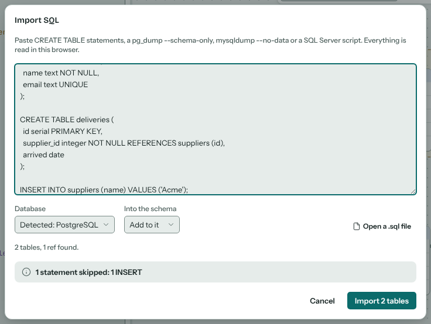

Everything is read in your browser; nothing is uploaded.

## Exporting

**Export** offers four formats. The DBML itself is the text in the editor, so to keep it as a `.dbml` file, copy it from there.

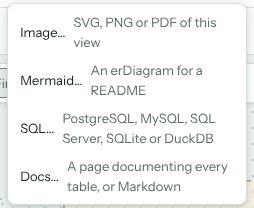

| Export | What you get |
| --- | --- |
| Image… | The diagram as drawn in the open view (or just the selected tables) as SVG, PNG or PDF, in the light or dark theme. A PNG can be 1x, 2x or 4x the size on screen, with a transparent background if you like, and **Copy image** puts it on the clipboard. |
| Mermaid… | The view as a Mermaid `erDiagram`, at its detail level, which GitHub draws inside a `mermaid` code block in a README. |
| SQL… | The script that creates the schema in PostgreSQL, MySQL, SQL Server, SQLite or DuckDB, shown before you **Copy** it or **Download schema.sql**. **Include records** adds `INSERT` statements for the DBML's records. |
| Docs… | One HTML page documenting every table, its columns, keys, indexes and refs, the enums and the groups, with the diagram of each view, a contents list and a search box. It loads nothing from anywhere, so it opens offline and can go on any web server. It can also be written as Markdown with a Mermaid diagram. |

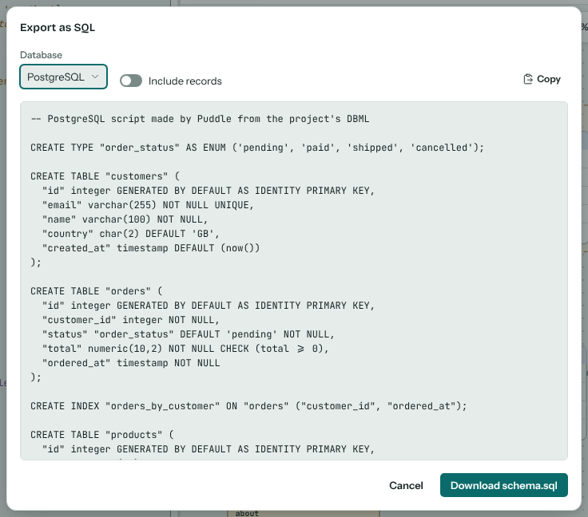

Each database names some types differently and lacks some features. Puddle writes each type in the database's own words, and lists under **Check before running it** any type it has no word for, written as given, and anything else that database can't do.

## Schema tables

A table in the schema can hold real rows. Every table you design appears under **Schema tables** in the **Add** menu. Pick one to add a Schema table node: Puddle creates the table in DuckDB with its keys, types, defaults and checks, and fills it with the DBML's records. **Add all tables** in the Schema view adds a node for every table at once, laid out as the diagram has them.

To load data into a table, wire a node into its Schema table node, or right-click any node on the canvas and pick **Load into** and the table.

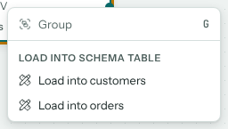

The inspector matches the table's columns to the incoming columns by name. Under **Load**, pick a different column for any that are named differently, or choose to leave a column empty or take its default. **Include example records** says whether the DBML's example records load too.

Each row is checked against the table's keys, types and checks before it goes in. If some can't load, the node says why, such as "2 rows have a customer_id that is already in the table or repeated", and **Show failing rows** shows them.

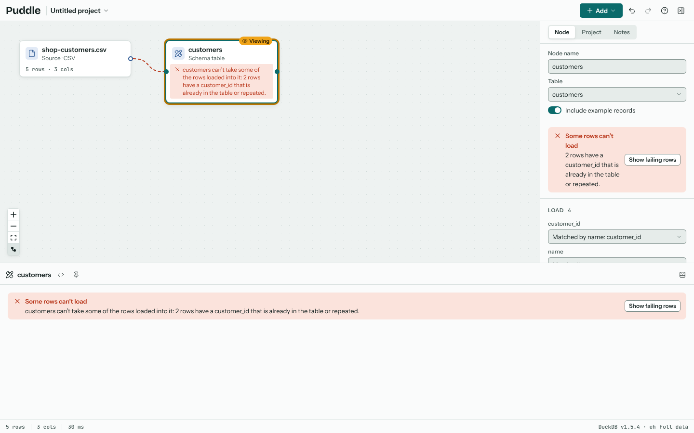

A Schema table node is rebuilt whenever the DBML changes. If DuckDB couldn't be given part of the design as written, the inspector lists it under **Built with changes**.

## Sample data

**Fill with sample data**, in the toolbar or a table's menu, writes made-up rows for the selected tables (or every table in the view) into the DBML. The rows keep the design: types, keys, enums, checks and refs. If a table refers to another that has no rows yet, that table is filled too, parents first, so every ref finds its match.

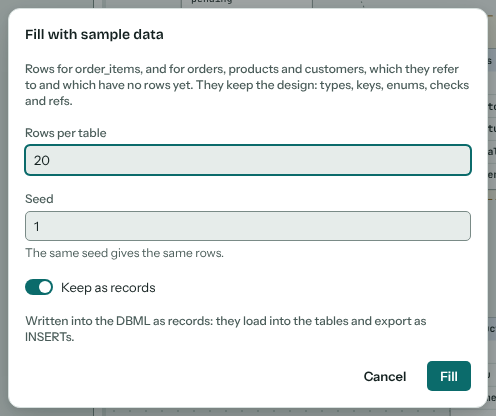

**Rows per table** can be up to 10,000. The same **Seed** always gives the same rows. With **Keep as records** on, the rows are written as `records` that load into the tables and export as `INSERT` statements. Off, they are example records: they load into the tables and show in the data sample, but stay out of SQL exports.

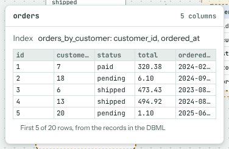

## Checking data against the schema

Any node with data can be checked against one of the schema's tables, without loading it. Select the node and, in the inspector's **Rules** section, pick the table under **Check against the schema**. Puddle turns what the design says about that table into rules on the node:

- the primary key and each unique column or index: no value repeats,
- each not null column and the primary key: never empty,
- each enum column: only the enum's values,
- each check: holds on every row,
- each ref, when the project has a Schema table node for the other table: every value exists there,
- each column with a number, date or true-or-false type: reads as that type, as a warning.

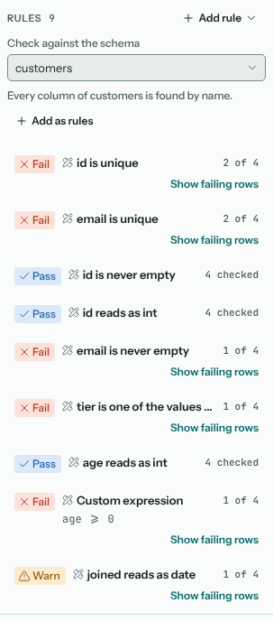

Each rule is marked as from the schema, and is rewritten whenever the DBML changes, keeping the switches you set on it. If the data names a column differently, match it under the table's name. **Add as rules** keeps the rules as the node's own, to edit like any other, and stops following the schema. Loading a node into a Schema table checks it against that table.

See {doc}`quality-rules` for what rules do once they're on a node.

## Versions

**Versions** keeps named points in the schema's history, inside the project. Type a **Label** (or leave it for the next number) and **Save version**. Pick a version to compare it with the current text, or with another version.

- **Changes** lists what changed, in words, table by table: "Added column phone (varchar(20))", "Removed table products".
- **DBML** shows both texts with the added and removed lines marked.
- **Migration** writes the script that takes a database from the older version to the newer, for the database you pick, to **Copy** or **Download migration.sql**. Statements that lose data, such as dropping a table, are listed first, and anything that has to be done by hand is said. Puddle doesn't connect to databases, so the script is for you to read and run.

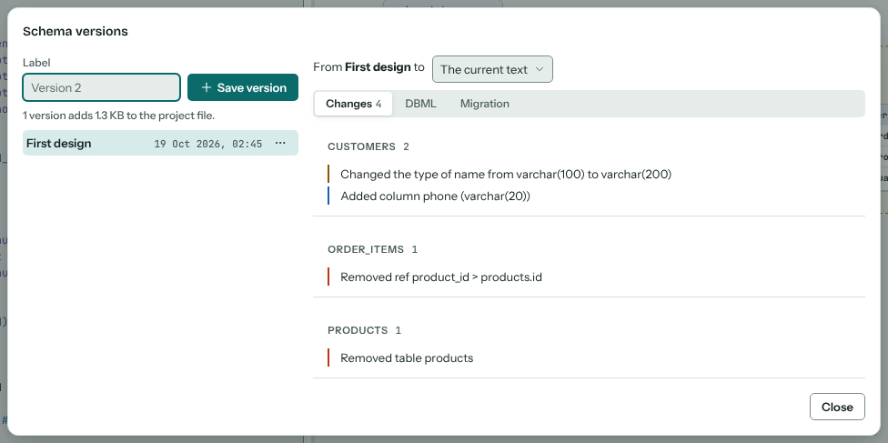

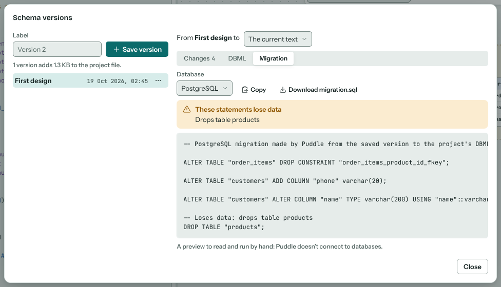

The **…** menu beside a version can **Restore** it, which makes it the current text (**Undo** takes that back), **Rename…** it or **Delete** it. The dialog says how much the versions add to the project file.

## Sharing

**Share** makes a link that carries the schema itself, with the layout and the views, in the part of the address after `#`, which browsers never send to a server. Anyone with the link can read the schema, so share it as you would the DBML. The dialog says how long the link is; a link over 32 KB may be cut short by some browsers and chat apps, so share the DBML or the docs export instead.

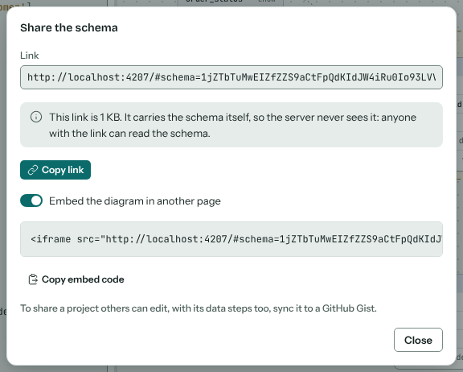

Opening the link shows the schema read-only, with a tab for each view. Tables can be moved for a better look, but nothing is kept. **Open in a new project** makes a project of it to edit.

**Embed the diagram in another page** gives the HTML for an `<iframe>` that shows just the diagram, for a wiki or a web page that allows iframes.

To share a project that others can edit, with its data steps, sync it to a GitHub Gist (see {doc}`projects`).

## In a pipeline

`puddle-run schema` does the Schema view's jobs from the command line, on a project file or a `.dbml` file: it checks the DBML for mistakes and writes the SQL, the docs, Mermaid or a migration from an older version, so a repository that keeps its design as DBML can check it in CI. See {doc}`self-hosting` and the [deployment README](https://github.com/kevinmcaleer/puddle/blob/main/deploy/README.md#schemas-in-a-pipeline-puddle-run-schema).
