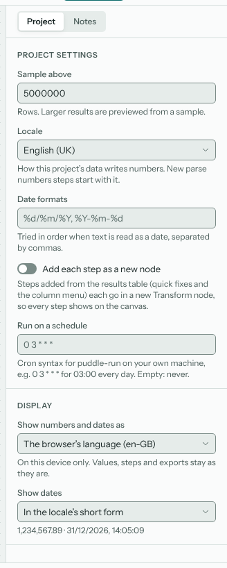
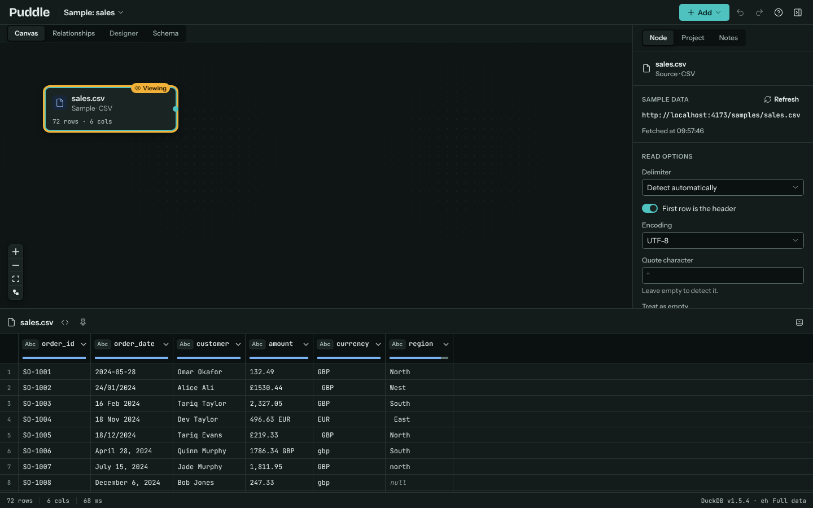
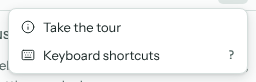
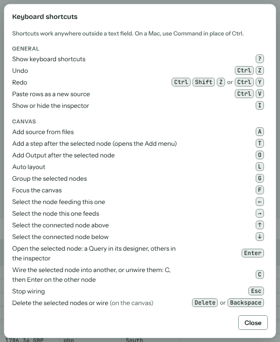

# Settings and shortcuts

## Project settings

The inspector's **Project** tab holds the project's settings. They're saved with the project.

Sample above
: The row count above which Puddle previews on a sample of each large source (see {doc}`sources`). Exports always use everything.

Locale
: How this project's data writes numbers, such as whether the decimal mark is a point (`1,234.50`) or a comma (`1.234,50`). New **Parse numbers** steps start with it.

Date formats
: The formats tried, in order, when text is read as a date, such as `%d/%m/%Y, %Y-%m-%d`.

Add each step as a new node
: Steps added from the results table, by the column menu or a quick fix, each go in a Transform node of their own, so every step shows on the canvas. See {doc}`cleaning`.

Run on a schedule
: When `puddle-run` should run this project, in cron syntax (`0 3 * * *` is 03:00 every day). Only used by a runner that has the project file; the browser never runs anything on its own. See {doc}`self-hosting`.

## Display

Below the project settings, **Display** sets how numbers and dates are shown on this device only. It changes nothing in your data, steps or exports.

Show numbers and dates as
: The browser's language, or a locale you choose.

Show dates
: In the locale's short form, or as ISO 8601 (2026-12-31).

## Theme

**Theme**, in the **Help** menu, picks between matching your system, light and dark.

## Help and keyboard shortcuts

The **Help** menu starts the guided tour again (or picks it up where you left it) and lists the keyboard shortcuts. Press **?** anywhere outside a text field to see them. On a Mac, use Command in place of Ctrl.

Puddle selects text like an app, not a web page: dragging across the canvas, menus or panels selects nothing, and Ctrl+A never selects the whole page. Text you type, SQL console answers, notes previews, code and messages can still be selected and copied, and Ctrl+A in one of them selects just that text.

## Working offline

After your first visit Puddle keeps itself, its engine and its extensions in the browser, so it opens and runs with no network. Your data files are never cached: they're read from your disk each time.
