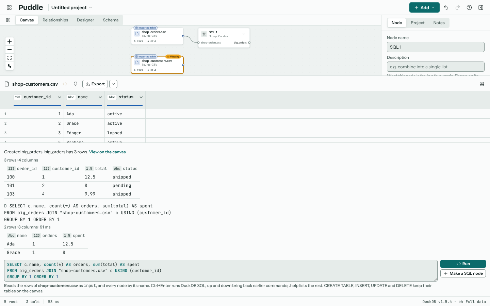

# The DuckDB shell

The SQL console under the results is a DuckDB shell. Type DuckDB SQL as you would in DuckDB's own shell and press Ctrl+Enter: each command's answer appears in the shell's history above the prompt, and the tables you make or change are nodes on the canvas, so you can see them in the results table, join them and export them like any other.



Open it with the code button at the right of the results bar (**Show the SQL console**). Nothing leaves your browser: the shell runs on the same DuckDB as the rest of Puddle.

## Tables by name

Every node of the project is a table the shell can read, by the node's name: `SELECT * FROM orders`, or in double quotes when the name has spaces or dots, `FROM "shop-orders.csv"`. The node whose rows the results table shows is also `input`. A name two nodes share isn't readable until one is renamed.

- `.tables` (or `SHOW TABLES`) lists the tables, each with its kind and number of columns. Click a name to view its rows in the results table. `.tables ord%` lists the ones whose names match, as SQL's `LIKE` does.
- `DESCRIBE name` (or `SHOW name`) lists a table's columns and their types; `DESCRIBE SELECT ...` does the same for a query.
- `SUMMARIZE name` gives each column's statistics: its smallest and largest values, the number of distinct values, the average, quartiles and the share of nulls.
- `EXPLAIN SELECT ...` shows how DuckDB runs a query.
- `.schema` writes `CREATE TABLE` for every table, `.schema name` for one.

A query's answer shows up to 200 rows. Several statements separated by semicolons run one after another.

## Making and changing tables

Statements that make or change a table keep the table in the project:

```sql
CREATE TABLE notes (id INTEGER, note VARCHAR);
INSERT INTO notes VALUES (1, 'first'), (2, 'second');
UPDATE notes SET note = upper(note) WHERE id = 2;
```

The first table the shell makes goes into a new SQL node, and the table gets a **Script table** node of its own after it, as a script in a SQL node does (see {doc}`combining`). The statements after it are added to the same SQL node's script, and a change to a table goes to the script that made it, so the script reads as the commands you typed. After each change the shell shows the table's first rows and how many it has; **View on the canvas** shows the table in the results table.

| Statement | What it does |
|---|---|
| `CREATE TABLE name AS SELECT ...` | A table from a query. `CREATE OR REPLACE` makes an existing one again. |
| `CREATE TABLE name (column TYPE, ...)` | An empty table with these columns. Keys and constraints are left out. |
| `INSERT INTO name VALUES (...)` or `SELECT ...` | Adds rows, by position, or by name with `INSERT INTO name (a, b)` or `INSERT INTO name BY NAME`. |
| `UPDATE name SET column = value WHERE ...` | Changes the rows the condition holds for. |
| `DELETE FROM name WHERE ...` | Removes the rows the condition holds for; without `WHERE`, every row. |
| `ALTER TABLE name ADD COLUMN`, `DROP COLUMN`, `RENAME COLUMN ... TO`, `ALTER COLUMN ... TYPE` | Changes the table's columns. |
| `ALTER TABLE name RENAME TO new_name` | Renames the table and its node. |
| `DROP TABLE name` | Removes the table, and its node unless something reads it. |

Each command is one step: Ctrl+Z takes it back. The shell changes only the tables it (or a SQL script) made: a source or a step's rows stay as they are, so copy one first, `CREATE TABLE my_orders AS SELECT * FROM orders`, and change the copy.

A table is kept as the statements that make it, never as its rows: when the file behind it changes, the table follows. That is also why a few things work a little differently from DuckDB's own tables. `UPDATE` gives a column the type of the values it sets when they differ (setting a whole-number column to `total * 1.1` makes it a decimal column), and `INSERT` widens a column the same way.

## Commands that can't run here

The browser can't reach your disk, so the shell refuses, saying what to do instead:

- `ATTACH`, `.open` and `USE`: add the database file (DuckDB, SQLite or Access) as a source from the **Add** menu, and read its tables by name.
- `COPY`, `EXPORT DATABASE`, `.output`: view the table and use **Export**.
- `INSTALL` and `LOAD`: Puddle loads the extensions it needs itself.
- `SET` and `PRAGMA`: Puddle keeps DuckDB's settings itself; number and date formats are under **Project settings**.
- `BEGIN`, `COMMIT` and `ROLLBACK`: each command is one undo step instead.

Reading files by name, as `read_csv('...')`, works in a SQL node with the files wired in (see {doc}`combining`), not in the shell.

## Keys

| Key | Does |
|---|---|
| Ctrl+Enter | Runs the command. |
| Up, Down | On the first or last line, bring back earlier commands. The history is kept in this browser. |
| Ctrl+L | Clears the shell (as does `.clear`). |

`.help` lists all of this in the shell. **Make a SQL node** keeps the query at the prompt as a SQL node after the viewed node.
