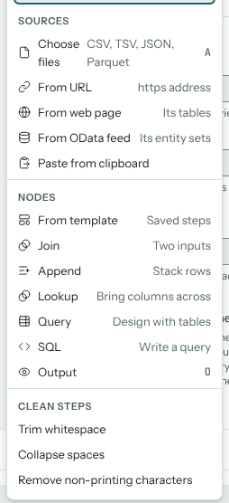
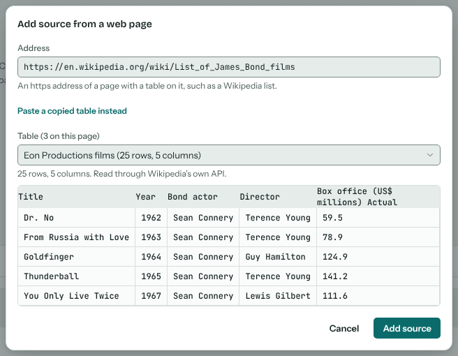
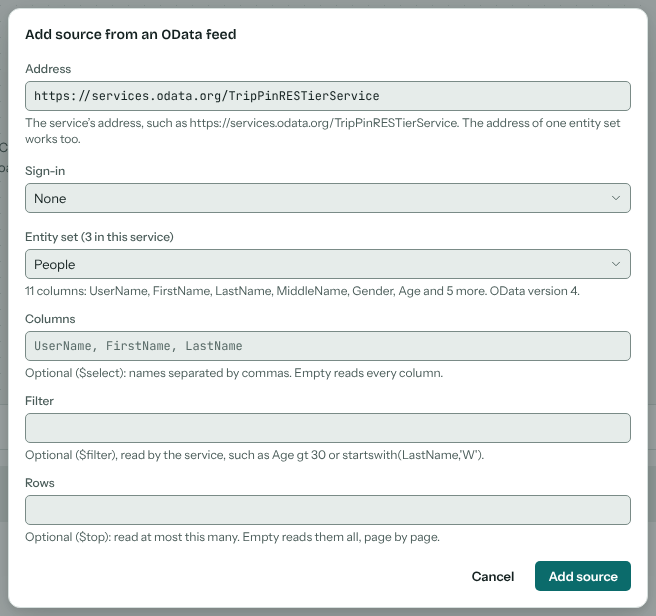
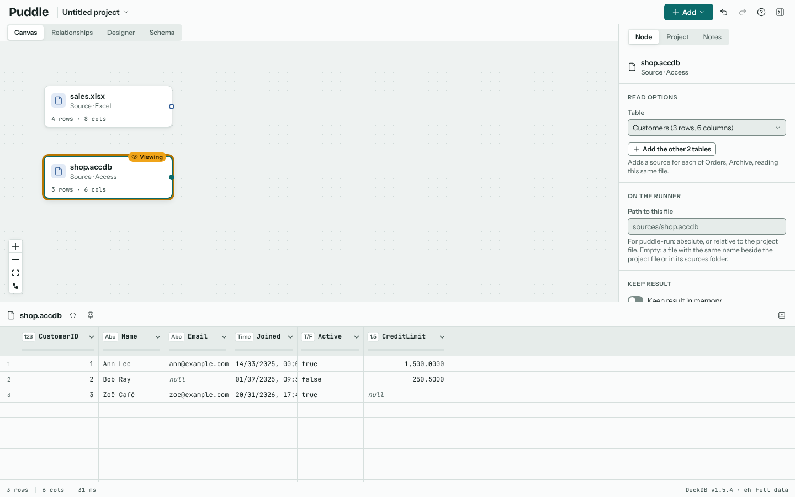
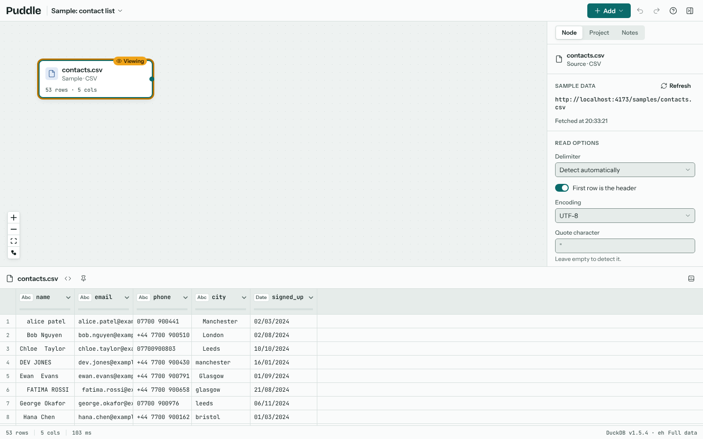
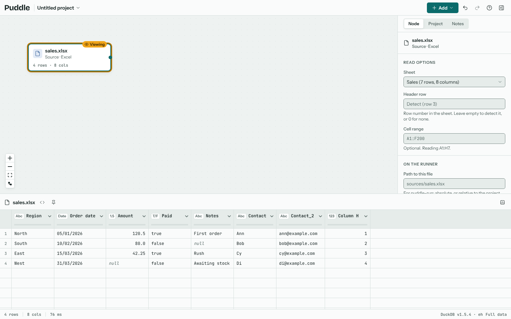

# Sources

A source is data read into Puddle: a file on your computer, a file at a web address, a table on a web page, an OData feed, or rows pasted from the clipboard. Each source is a node on the canvas, and its data stays where it is. Puddle reads it in place each time and never copies it anywhere.

## Adding a source

**Add** in the toolbar offers six ways in under **Sources**; an empty project also has an **Add source** button on the canvas.



Choose files
: Pick one or more files from your computer (shortcut: A). You can also drop files straight onto the canvas.

From URL
: Read a CSV, TSV, JSON, NDJSON, Parquet or XML file from an https address. Puddle fetches it again each time the project opens, and **Refresh** in the inspector fetches it on demand. The site must allow browsers to read it (CORS).

From web page
: Read a table from a web page, such as a list on Wikipedia. See [Tables on a web page](#tables-on-a-web-page).

From OData feed
: Read an entity set from an OData service, such as SAP, Dynamics or SharePoint lists. See [OData feeds](#odata-feeds).

From database
: Make or pick a saved connection to a database (shortcut: D), then tick the tables to read, or write a query, and each becomes a source. Connections are saved in the project without their password or token, which stays in this tab; **Project › Databases** lists them. See [Databases](#databases).

Paste from clipboard
: Paste rows copied from a spreadsheet or a web page, or XML text, as a new source (shortcut: Ctrl+V on the canvas). Pasted rows are the one kind of data a project keeps, because there is no file to read them from again.

Puddle reads these formats:

| Format | Extensions | Notes |
| --- | --- | --- |
| CSV and TSV | `.csv`, `.tsv`, `.tab`, `.txt` | The delimiter, header row, encoding and quoting are detected, and can be changed in the inspector. Ragged rows are padded rather than rejected. |
| Excel | `.xlsx` | Choose the sheet, the header row and an optional cell range. |
| JSON and NDJSON | `.json`, `.ndjson`, `.jsonl` | An array of objects, or one object per line. |
| Parquet | `.parquet`, `.pq` | Read directly, with its column types. |
| XML | `.xml` | The repeating element is read as rows. See [XML](#xml). |
| Access | `.accdb`, `.mdb` | Choose the table; add the database's other tables as sources of their own. See [Access databases](#access-databases). |

## Tables on a web page

**From web page** reads a table from a page, the way Power Query's *From Web* does. Paste the page's address and choose **Find tables**: Puddle lists every table on the page, named by its caption or the heading above it, with its size and a preview of its first rows. The biggest table is chosen to start with, since it's usually the one the page is about. Pick the one you want and choose **Add source**.



For example, to get every James Bond film: paste `https://en.wikipedia.org/wiki/List_of_James_Bond_films`, choose **Find tables**, pick the table of films, and add it. The columns come in typed, so the year is a number, and Puddle tidies what a table shows rather than what its HTML holds:

- A header over two rows becomes one name per column, such as *Box office Actual*.
- A cell spanning several rows (one actor across five films) is repeated in each row.
- Footnote markers such as *[12]*, hidden sort keys and edit links are dropped.
- A table with no header row takes its first row as the column names.

The source keeps the page's address and which table it reads. Like a file from a web address, the page is fetched again each time the project opens, and **Refresh** fetches it on demand; if the table changed, Puddle says so. If tables are added above it, Puddle still finds it by its name.

Puddle reads the page straight from your browser, so the site has to allow it, and most sites don't (CORS). Wikipedia's pages are read through Wikipedia's own API, which does allow it, so any Wikipedia article works. For any other site that refuses, Puddle says so and offers **Paste instead**: select the table on the page in your browser, copy it, and paste it into the box. The table's HTML comes with it, so its columns stay intact, and it's added like other pasted rows, kept in the project. Pasting the page's HTML source works too.

`puddle-run` can't read a table on a web page yet; its `check` says so.

## OData feeds

**From OData feed** reads an entity set from an OData service, the way Power Query's *OData Feed* does. Paste the service's address and choose **Connect**: Puddle reads the service's `$metadata` (or, if it has none, its service document) and lists its entity sets, with their columns. Pick one and choose **Add source**. Puddle reads every page of it, following the service's next links, so a service that pages its results by a few hundred rows still comes in whole.



For example, to try it on Microsoft's sample service: paste `https://services.odata.org/TripPinRESTierService`, choose **Connect**, and add **People**. The address of one entity set works too, as copied from a browser's address bar; Puddle finds the service above it and fills in any query options the address carries.

Three optional fields narrow what's read, and the service does the work, so less comes over the network:

Columns
: `$select`: column names separated by commas, such as `UserName, FirstName, Age`. Empty reads every column.

Filter
: `$filter`, written in OData's own filter language, such as `Age gt 30` or `startswith(LastName,'W')`. If the service can't read it, Puddle shows the service's own message.

Rows
: `$top`: read at most this many rows.

The columns come in with the types `$metadata` gives them:

| OData type | Read as |
| --- | --- |
| `Edm.String`, `Edm.Guid`, enums | Text (a Guid as DuckDB's `UUID`) |
| `Edm.Int16`, `Edm.Int32`, `Edm.Int64`, `Edm.Byte`, `Edm.SByte` | Whole numbers |
| `Edm.Decimal`, `Edm.Double`, `Edm.Single` | Decimals, with the precision and scale `$metadata` gives where it gives them |
| `Edm.Boolean` | True or false |
| `Edm.Date` | A date |
| `Edm.DateTime`, `Edm.DateTimeOffset` | A timestamp; one with an offset is converted to UTC |
| `Edm.TimeOfDay`, `Edm.Time` | A time of day |
| Complex types, collections, geography, `Edm.Duration`, `Edm.Binary` | Their text, as JSON for structured values; use a step to pull out what you need |

Both versions of OData that services still speak are read: version 4, and versions 2 and 3 (the JSON with `d` that older SAP and SharePoint services send). Navigation properties (links to other entity sets) are left out; add the other entity set as its own source and join the two.

### Signing in

If the service needs a sign-in, choose **Basic** (a user name and password) or **Bearer token** under **Sign-in** before you connect. The sign-in is kept in this browser tab only: it is never saved in the project, its `.puddle.json` file, a recipe or a sync. Reopen the project in a new tab and the source asks for it again in the inspector, under **Sign in and read**.

### Services that block other sites

Puddle reads the feed straight from your browser, with no server of its own in between, so the service has to allow other sites to read it (CORS). Some public services do; many company services don't, and then Puddle says that the service blocked it. A service that needs a sign-in must also allow the Authorization header. Ask the service's owner to allow Puddle's address, or export the data from the service as a file and add that instead.

Like a file from a web address, the feed is read again each time the project opens, and **Refresh** reads it on demand; if its rows changed, Puddle says so.

`puddle-run` reads OData feeds itself (with no CORS limits, since it runs outside a browser), except those that need a sign-in, which it can't give yet; its `check` says so.

## XML

An XML file holds its records as an element repeated under one parent, such as each `<book>` in a `<catalog>` or each `<entry>` in an Atom feed. Puddle finds the repeating elements and reads the likeliest one as rows, one row per element. Attributes and child elements become columns:

```xml
<book id="bk102">
  <title>Good Omens</title>
  <price currency="GBP">9.50</price>
  <author>Terry Pratchett</author>
  <author>Neil Gaiman</author>
</book>
```

gives the columns *id*, *title*, *price*, *price.currency* and *author*. A nested element is named by its path, such as *address.city*. Namespace prefixes are dropped. Values are typed the way a CSV's are, so *9.50* is a number and dates are dates, and text keeps its spaces for the cleaning steps.

An element that repeats inside a record, like the two authors above, stays in one column as a JSON list: `["Terry Pratchett","Neil Gaiman"]`. To give each one a row of its own instead, with the record's other values repeated, choose it under **A row for each** in the inspector.

The inspector lists every repeating element under **Record element**, with how many there are, so you can read another one as the rows (each author, say).

XML can come from a file, from a web address (Puddle recognises `.xml` addresses and servers that say they send XML, including Atom and RSS feeds), or pasted as text. Puddle reads it in your browser, a piece at a time, so a large file doesn't have to fit in memory as a document; the rows it finds do. `puddle-run` reads XML sources the same way.

## Access databases

An Access database (`.accdb`, or `.mdb` from Access 2003 and before) holds several tables. Add the file like any other and Puddle reads its first table; the inspector lists every table with its size under **Table**, so you can read another one instead. **Add the other tables** adds a source for each table not yet in the project, reading the same file, so you can join them on the canvas or see how they relate in the Relationships view.



The columns keep their Access types:

| Access type | Read as |
| --- | --- |
| Short Text, Long Text, Hyperlink | Text |
| Number (Byte, Integer, Long Integer), AutoNumber | Whole numbers of the same size |
| Number (Single, Double) | Decimals |
| Currency, Number (Decimal) | Exact decimals, so no pennies are lost to rounding |
| Large Number | A big whole number |
| Date/Time | A timestamp, as written in Access (Access keeps no time zone) |
| Yes/No | True or false |
| Replication ID | Text |
| Attachment | The attached files' names |
| OLE Object, binary | Bytes (`BLOB`) |

Only the tables are read: queries, forms and reports stay in Access. Linked tables point to data elsewhere, so they are left out; add that data directly. A database encrypted with a password can't be opened: in Access, remove the password (*File › Info › Decrypt Database*), save it, and add it again. Like an Excel workbook, the database is read into memory whole, so for a very large one (Puddle warns above 200 MB) export the tables you need from Access as CSV.

Puddle reads the database in your browser; nothing is uploaded. When you open the project again, choose the database once and every table read from it connects. `puddle-run` reads Access tables the same way, with the same types.

(sources-databases)=
## Databases

**Add › From database** reads tables from a database into sources. Pick a saved connection, or make one from the grid of databases; a connection needs the database's address and user name, and its password or token, which is kept in this tab only and never saved in the project, a recipe or a shared link. **Test** opens the connection and says what answered.

Database files are read in your browser; nothing is uploaded. A database file chosen from **Add › Choose files** (or dropped on the canvas) becomes a connection named after the file, and its table picker opens at once:

SQLite
: A `.sqlite` or `.db` file (a LibSQL file is one too). Choose the file in the connection form.

DuckDB
: A `.duckdb` file, attached read-only, so its own types and views are read as they are.

Once the connection is saved, **Read from** lists the database's tables and views with their columns and sizes. Tick the ones to read, or write a query in the database's own SQL, and set how many rows to read at most (empty reads them all). Each table and the query become a source on the canvas, read through the connection with the types the database declares.

**Browse**, on a connection in the list or in a connection source's inspector, opens the database browser in the inspector's place: the database's schemas, tables and views with their columns and types, a search over table and column names, a preview of a table's first 100 rows when its name is clicked, and checkboxes with **Add N tables** to add the ticked ones as sources (or drag a table onto the canvas). A query typed in its box becomes a source with **Add query**. **Refresh** reads the tables again. **Document the schema** (or **Document N tables**, with some ticked) writes the database's tables, keys, indexes, foreign keys and views into the project's {doc}`schema` as a group named after the connection; the same button is on each connection under **Project › Databases**, which also says when it was last documented.

A connection source's inspector shows its table or query and the row limit; change either and the rows are read again, or press **Refresh** to read them again as they are now. **Edit** opens the connection. The catalogue is kept on the connection, so the inspector lists the other tables without connecting again.

Databases behind a server (PostgreSQL, MySQL, SQL Server and the rest of the grid) are read through **puddle-connect**, a small service that speaks the database protocols a browser cannot. Under **Where it runs**, a connection is **On this computer** when `npx puddle-connect` is running there (Puddle finds it at `localhost:8765`), or **On the Pi** when the service runs behind the site, which asks for its token once and keeps it in the tab. The service reaches only the hosts it is allowed, runs one reading statement per request, bounds each read by a timeout and a row cap, and keeps nothing: the connection's settings and secret travel with each request and are never stored or logged. A SQLite file on the computer running the service is read by its **path**. Starting the service is in the [deployment guide](https://github.com/kevinmcaleer/puddle/blob/main/deploy/README.md). PostgreSQL, Amazon Redshift, CockroachDB and GreengageDB are read this way: the service opens a read-only session, lists the tables of every schema but the system ones, and documents keys, indexes, foreign keys, comments, enums and views. **Use SSL** turns on an encrypted connection, and **Check the certificate** (on by default) refuses a server whose certificate isn't trusted; turn it off for a self-signed one. MySQL, MariaDB and TiDB are read the same way: the tables of the connection's database, with `ENUM` columns documented as enums named after the table and column, a `TINYINT(1)` as a boolean, and a `TIME` kept as text since it may pass 24 hours. SQL Server is read with read-only intent, signed in with a SQL login, a Windows login (give the **Domain**) or an Entra ID access token (turn on **Sign in with an Entra ID token** and paste the token as the secret); its tables are documented from `sys.*` with extended properties (`MS_Description`) as notes, `money` as a four-place decimal and `datetime2` as a timestamp. Oracle Database is read from the user's own schema, named by its **Service name**: a `NUMBER` is held by its precision and scale (whole numbers as integers, fractions as decimals, unconstrained as a double), a `DATE` is a timestamp since it carries a time, and comments on tables and columns become notes. Firebird is read by its **Database path** on the server, optionally under a **Role**, with a `BLOB SUB_TYPE TEXT` as text. SQL Anywhere stays on the grid but isn't read: SAP's client isn't available for the Pi, so its connection can be kept for later. Drivers for the other server databases land family by family; until a driver lands, its connection can be made and kept, but not read.

When you open the project again in another tab, a database file is chosen again, as any file is, from the source's results pane or inspector; a password or token is typed again, since it was never stored.

## Read options

Select a source to see how it is read in the inspector. For a CSV file that is the delimiter, whether the first row is the header, the encoding, the quote character and which values count as empty (such as `NA` or `n/a`). Change any of them and every node after the source updates.



An Excel source shows the workbook's sheets with their sizes, the header row it detected (often below a title or a few blank rows), and the cell range being read. An Access source shows the database's tables (see [Access databases](#access-databases)). An XML source shows its record element and what gets a row of its own (see [XML](#xml)).

A file source also has **Path to this file** under *On the runner*: where `puddle-run` finds the file when it runs the project outside the browser (see {doc}`self-hosting`). Left empty, the runner looks for the file by name beside the project file or in a `sources/` folder there.



## Large files

Files are read from disk in pieces, so a source can be larger than your computer's memory. Above a row threshold (five million rows unless you change **Sample above** in the project's settings) Puddle previews, profiles and checks rules on the first rows of each large source so editing stays fast. The results say when you're looking at a sample, one click runs on the full data, and exports always read everything.

**Keep result in memory**, in the inspector of any node, stores that node's result inside DuckDB so the nodes after it read it rather than re-running everything before it. It's worth turning on after an expensive step, such as a join of two big files.

## Reopening a project

Projects save how to read each file, not the file itself. When you reopen a project, a note headed **Files from last time** lists the files it needs. In Chrome or Edge, Puddle asks once for permission and reconnects every file in one click. Firefox and Safari can't keep access to files between visits, so the note's button (**Choose 2 files**, say) takes them all in one go: pick every file at once, and each goes to the source with its name (a renamed file goes to the one source of its kind still waiting). You can also choose a file from its own node. Either way, Puddle checks that the file you choose is the one the project was built on.
