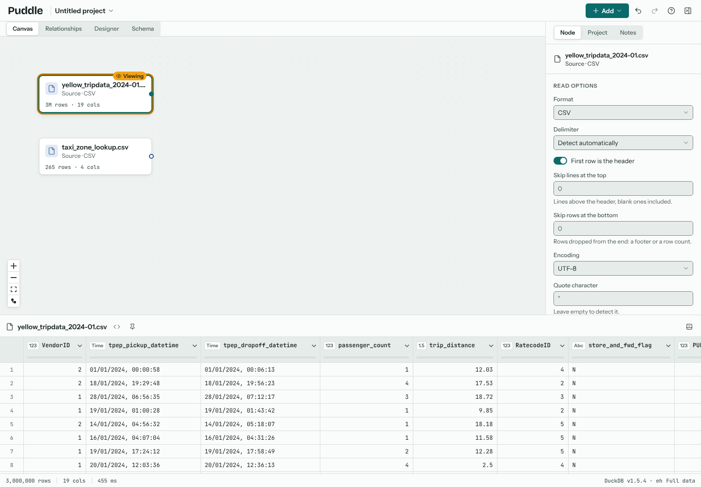
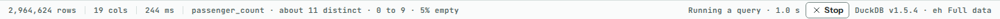
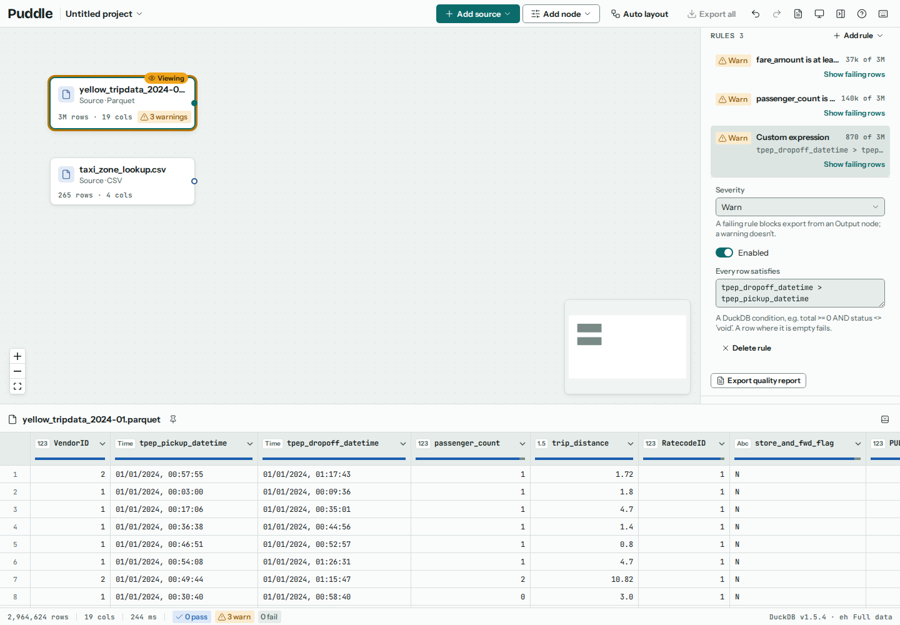
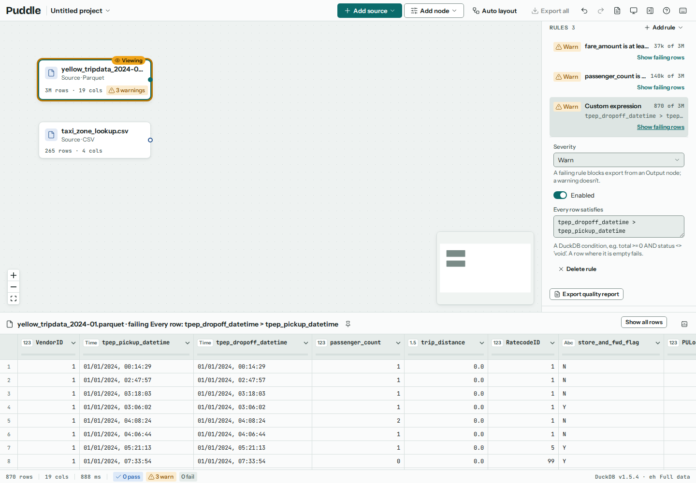
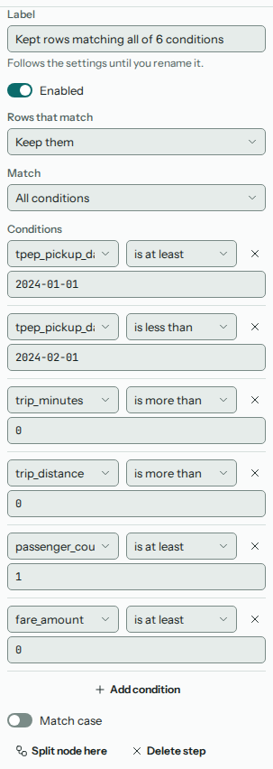
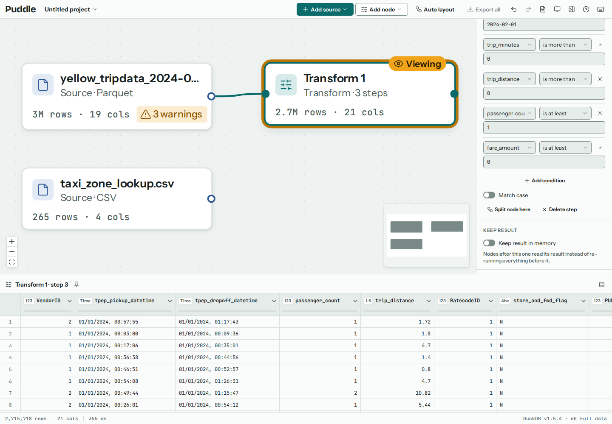
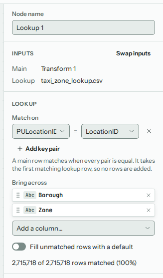
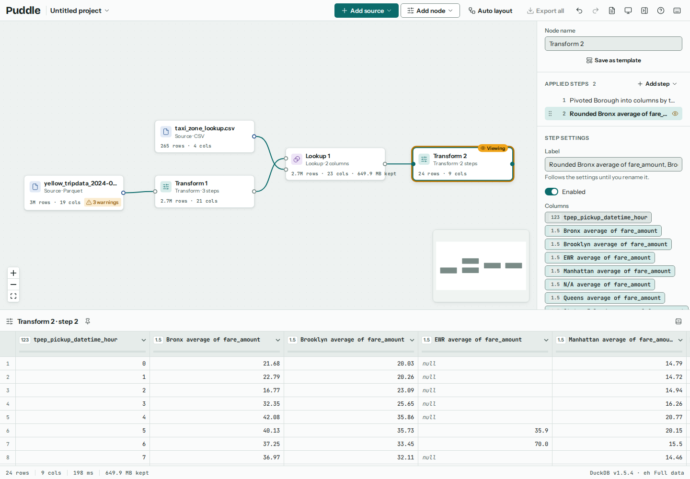
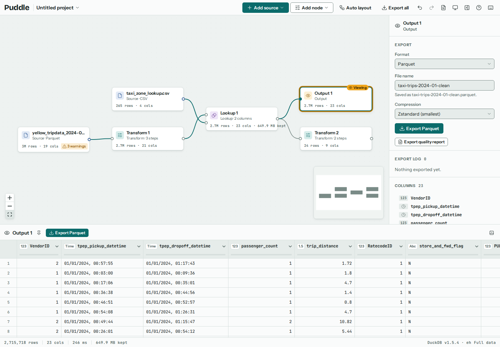

# Tutorial: three million taxi trips

This tutorial cleans a month of New York's yellow cab trips: nearly three million rows, read and reshaped entirely in your browser. On the way it uses most of what Puddle does: a Parquet and a CSV source, column profiles, quality rules, date steps, a filter, a lookup, a kept result, a pivot and a Parquet export.

## The data

New York's Taxi and Limousine Commission (TLC) publishes every trip its licensed cabs make, month by month, on its [trip record data](https://www.nyc.gov/site/tlc/about/tlc-trip-record-data.page) page. The TLC publishes them as open data, free to use, and notes that it makes no representations as to their accuracy. That is what makes them good practice: the records come straight from the meters, mistakes and all.

Download two files from that page:

| File | What it is |
| --- | --- |
| [`yellow_tripdata_2024-01.parquet`](https://d37ci6vzurychx.cloudfront.net/trip-data/yellow_tripdata_2024-01.parquet) | Yellow Taxi Trip Records for January 2024: 2,964,624 trips in 19 columns, about 50 MB. |
| [`taxi_zone_lookup.csv`](https://d37ci6vzurychx.cloudfront.net/misc/taxi_zone_lookup.csv) | The Taxi Zone Lookup Table: the borough and name of each of the 265 zones the trips start and end in. |

The [data dictionary](https://www.nyc.gov/assets/tlc/downloads/pdf/data_dictionary_trip_records_yellow.pdf) explains each column. The ones this tutorial uses are the pickup and dropoff times (`tpep_pickup_datetime`, `tpep_dropoff_datetime`), `passenger_count`, `trip_distance`, `fare_amount` and the pickup zone, `PULocationID`.

Nothing is uploaded at any point. Puddle reads both files from your disk, and everything below runs in DuckDB inside the browser tab.

### Or start from Puddle

Choose **Help**, then **Start the taxi tutorial**. Puddle opens a new project called *Tutorial: three million taxi trips* with both files already added as sources, and a note that links back here. Skip step 1 and carry on from {ref}`step 2 <look-before-you-clean>`.

The TLC's site doesn't let other sites' pages read its files, so Puddle's own server fetches them from the TLC for you as your browser reads them, and keeps nothing (see {doc}`self-hosting`). The trips are still read and cleaned in your browser. This needs Puddle's container or `npm run dev`; elsewhere, download the files as above.

## 1. Add the files

Open a new project and choose **Add**, then **Choose files**, and pick both files (or drop them on the canvas). Each becomes a source node. The trips file says how many rows it has once DuckDB has counted them; Parquet files carry their column types, so the timestamps and numbers arrive ready to use.

Puddle can also read a file from its web address with **From URL**, without downloading it first, when the server lets browsers read it (see {doc}`sources`). If the TLC's server doesn't, Puddle says so, and downloading the files is the way in.

(look-before-you-clean)=
## 2. Look before you clean

Click a column header in the results and the status strip profiles that column over all three million rows. `passenger_count` shows the first problem: it runs from 0 to 9, and 5% of it is empty. A trip with no passengers, or none recorded, can't be counted in a passengers-per-trip figure.

Try `fare_amount` and `trip_distance` too: some fares are below zero, and some trips have no distance at all.

## 3. Write down what's wrong, as rules

Rules turn what you just found into checks that run every time the data changes (see {doc}`quality-rules`). With the trips source selected, use **Add rule** in the inspector's Rules section to add three:

- **In a range** on `fare_amount`, with a lowest value of 0.
- **Never empty** on `passenger_count`.
- **Custom expression**: `tpep_dropoff_datetime > tpep_pickup_datetime`, since a trip can't end before it starts.

Set each one's **Severity** to *warning*. These rules describe the raw file, which is allowed to be messy; a failing *fail* rule would block every export after it. Each rule says how many rows break it: about 37 thousand negative fares, 140 thousand trips with no passenger count, and 870 trips that don't end after they start. The node shows a badge.

**Show failing rows** on the custom expression lists those 870 trips. Most have the same pickup and dropoff time and no distance: trips that never really happened.

**Show all rows** goes back to the whole table.

## 4. Clean the trips

With the trips source selected, choose **Add**, then **Time between dates**, which makes a Transform node after the source. A Transform node holds a list of steps, applied in order; add the other two from **Add step** in the inspector:

1. **Time between dates** (in Dates). From `tpep_pickup_datetime` to `tpep_dropoff_datetime`, in minutes, into a new column called `trip_minutes`.
2. **Extract date part** (in Dates). The **Hour** of `tpep_pickup_datetime`, into a new column `tpep_pickup_datetime_hour`, for the summary later.
3. **Filter rows** (in Rows). Keep the rows that meet all of these conditions, using **Add condition** for each:

   | Column | Comparison | Value |
   | --- | --- | --- |
   | `tpep_pickup_datetime` | is at least | `2024-01-01` |
   | `tpep_pickup_datetime` | is less than | `2024-02-01` |
   | `trip_minutes` | is more than | `0` |
   | `trip_distance` | is more than | `0` |
   | `passenger_count` | is at least | `1` |
   | `fare_amount` | is at least | `0` |

   The first two drop the handful of trips dated outside January.

The Transform node now shows how many trips survived: 2,715,718 of 2,964,624, about 92%. Click any earlier step in the list to see the data as it was at that point.

## 5. Look up the zones

`PULocationID` is a zone number. The zone lookup turns it into a borough and a zone name. Select the Transform node, then Shift+click `taxi_zone_lookup.csv`, and choose **Lookup** from **Add** (see {doc}`combining`). In the inspector:

- Under **Match on**, pair `PULocationID` with `LocationID`.
- Under **Bring across**, add `Borough` and `Zone`.

A lookup keeps every trip exactly once, and says how many found their zone: here, all of them.

Turn on **Keep result in memory** for the Lookup node. Everything after it then reads the looked-up trips straight from DuckDB's memory instead of reading, filtering and matching three million rows again at each change. The node says how much memory that takes, about 650 MB here.

## 6. Summarise

With the Lookup node selected, add another Transform and give it a **Pivot or group by** step (in Reshape; see {doc}`reshaping`). Drag `tpep_pickup_datetime_hour` to **Rows**, `Borough` to **Columns** and `fare_amount` to **Values**, then choose **Average** from the `fare_amount` field's menu. Add a **Round** step on the average columns, to two decimal places, to finish.

The result is 24 rows, one per hour of the day, with the average fare for trips starting in each borough. Read down a column to see when fares peak, and across a row to compare boroughs. The EWR column (Newark airport) is mostly empty: yellow cabs rarely pick up there, so most hours have no trips to average.

## 7. Export the clean trips

Select the Lookup node and choose **Output** from **Add**. In the Output node's settings, choose **Parquet** as the format and name the file `taxi-trips-2024-01-clean`. **Export Parquet** writes every clean trip, with its borough and zone, straight from DuckDB in your browser to your downloads (see {doc}`exporting`).

The rules on the source are warnings, so they don't hold the export back. The export log in the inspector records each export.

## Going further

- **More months.** The TLC publishes every month back to 2009. Download a few more, add them as sources and stack them with an **Append** node before the Transform; wire the Append node into the Transform in place of the January file. Above five million rows Puddle previews and checks a sample while you edit, and exports still read everything (see {doc}`sources`).
- **Where trips end.** Add a second lookup on `DOLocationID` to bring the dropoff zone across too. Set its **Suffix for clashing columns**, since `Borough` and `Zone` are already there.
- **Tips.** Add a column from an expression, such as `tip_amount / fare_amount`, and summarise it by hour instead of the fare.
- **Share the flow.** Export the project from the project menu. It holds the steps, rules and notes, never the trips, so it's small, and whoever imports it chooses the two files on their own machine (see {doc}`projects`).
