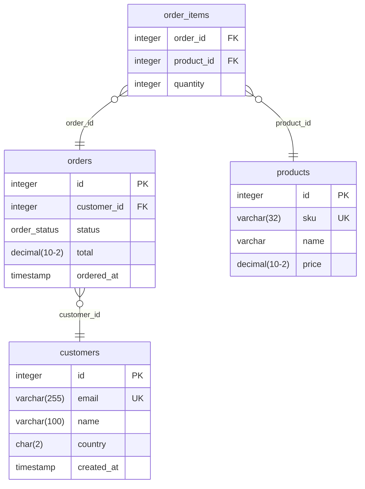

# Shop schema

Project shop · PostgreSQL · 4 tables · 3 refs · 1 enum

Customers, their orders and what they bought

## Contents

- [Tables](#tables)
  - [`customers`](#customers)
  - [`orders`](#orders)
  - [`products`](#products)
  - [`order_items`](#order_items)
- [Enums](#enums)
  - [`order_status`](#order_status)
- [Table groups](#table-groups)
  - [sales](#sales)
- [Notes](#notes)
  - [about](#about)

## Diagram

## Tables

### customers

Alias `C`

Everyone who has signed up

| Column | Type | Settings | Default | Note |
| --- | --- | --- | --- | --- |
| `id` | `integer` | pk, increment |  |  |
| `email` | `varchar(255)` | not null, unique |  |  |
| `name` | `varchar(100)` | not null |  |  |
| `country` | `char(2)` |  | `'GB'` |  |
| `created_at` | `timestamp` |  | `` `now()` `` |  |

**Refs**

| Columns | Relationship | Other table | Actions |
| --- | --- | --- | --- |
| `id` | one-to-many | [`orders`](#orders) `(customer_id)` |  |

### orders

| Column | Type | Settings | Default | Note |
| --- | --- | --- | --- | --- |
| `id` | `integer` | pk, increment |  |  |
| `customer_id` | `integer` | not null |  |  |
| `status` | [`order_status`](#order_status) | not null | `'pending'` |  |
| `total` | `decimal(10,2)` | not null, check: total >= 0 |  |  |
| `ordered_at` | `timestamp` | not null |  |  |

**Indexes**

| Columns | Name | Settings | Note |
| --- | --- | --- | --- |
| `customer_id, ordered_at` | orders\_by\_customer |  |  |

**Refs**

| Columns | Relationship | Other table | Actions |
| --- | --- | --- | --- |
| `customer_id` | many-to-one | [`customers`](#customers) `(id)` |  |
| `id` | one-to-many | [`order_items`](#order_items) `(order_id)` | on delete cascade |

### products

| Column | Type | Settings | Default | Note |
| --- | --- | --- | --- | --- |
| `id` | `integer` | pk, increment |  |  |
| `sku` | `varchar(32)` | not null, unique |  |  |
| `name` | `varchar` | not null |  |  |
| `price` | `decimal(10,2)` | not null |  |  |

**Refs**

| Columns | Relationship | Other table | Actions |
| --- | --- | --- | --- |
| `id` | one-to-many | [`order_items`](#order_items) `(product_id)` |  |

### order\_items

| Column | Type | Settings | Default | Note |
| --- | --- | --- | --- | --- |
| `order_id` | `integer` | not null |  |  |
| `product_id` | `integer` | not null |  |  |
| `quantity` | `integer` | not null | `1` |  |

**Indexes**

| Columns | Name | Settings | Note |
| --- | --- | --- | --- |
| `order_id, product_id` |  | pk |  |

**Refs**

| Columns | Relationship | Other table | Actions |
| --- | --- | --- | --- |
| `order_id` | many-to-one | [`orders`](#orders) `(id)` | on delete cascade |
| `product_id` | many-to-one | [`products`](#products) `(id)` |  |

## Enums

### order\_status

| Value | Note |
| --- | --- |
| `pending` |  |
| `paid` |  |
| `shipped` | Left the warehouse |
| `cancelled` |  |

## Table groups

### sales

- [`orders`](#orders)
- [`order_items`](#order_items)

## Notes

### about

Prices are in pounds
